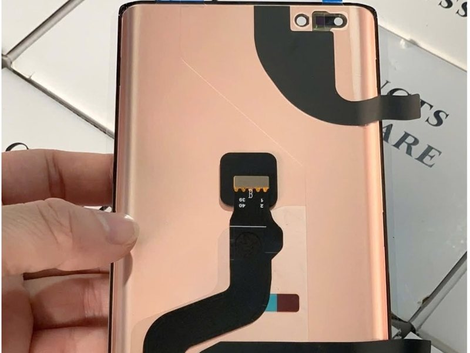
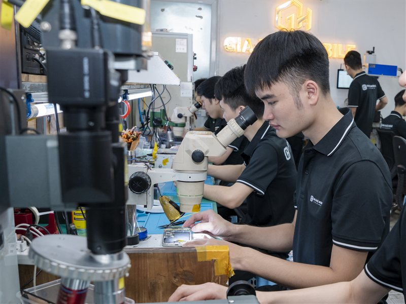
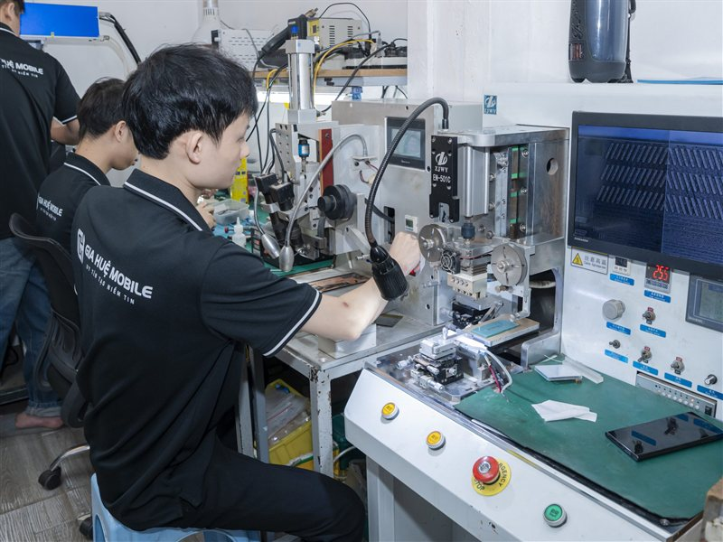
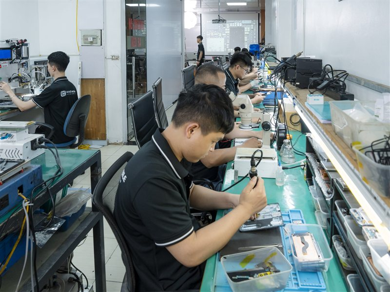
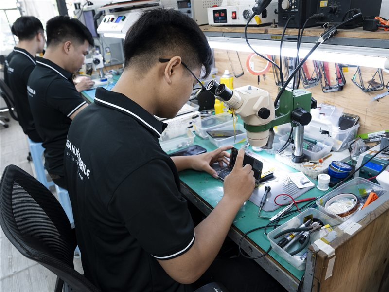
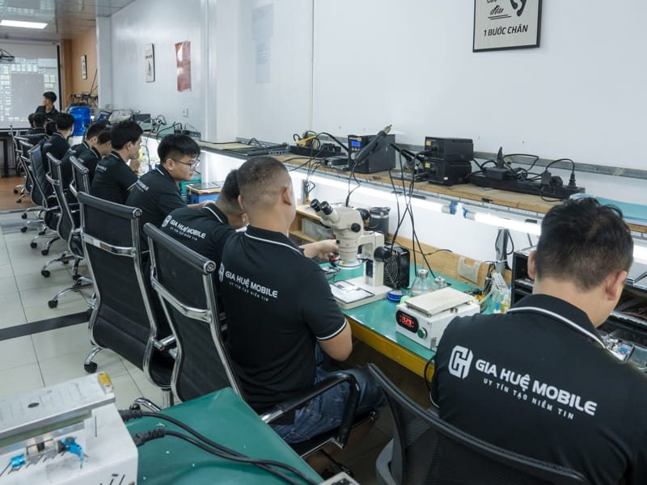

# Thay màn hình Huawei Mate 40 Pro

*Mặt sau một màn hình thay thế Mate 40 Pro: tấm nền màu đồng, cáp kết nối màu đen và lỗ camera trước kép ở góc trên. Màn được kiểm tra trước khi lắp cho khách.*

Màn hình Huawei Mate 40 Pro bị sọc, chảy mực, tối đen hay liệt cảm ứng **chưa chắc đã phải thay cả cụm màn**. Tại Gia Huệ Mobile, kỹ thuật viên kiểm tra máy trước và chỉ tư vấn thay khi tấm nền OLED đã hỏng. Màn mới được gắn thử để bạn tự kiểm tra hiển thị, cảm ứng, vân tay rồi mới lắp cố định. Cửa hàng luôn có sẵn linh kiện nên thay xong khoảng **45–60 phút**, nhận máy trong ngày, bảo hành **lỗi cảm ứng 1 đổi 1 trong 6 tháng**.

## Màn hình Mate 40 Pro khác gì máy thường?

Mate 40 Pro dùng **tấm nền OLED cong tràn hai cạnh**, tần số quét **90Hz**. Hai mép màn uốn sâu khoảng **88°**, ôm sát khung kim loại. Dưới màn là **cảm biến vân tay quang học**, phía trên có camera trước và cảm biến cho **nhận diện khuôn mặt 3D**.

Ba đặc điểm này ảnh hưởng trực tiếp tới việc sửa:

- **Mép cong dễ hỏng khi rơi cạnh.** Vì vậy sọc hay chảy mực trên máy này hay bắt đầu từ hai bên.
- **Vân tay quang học "nhìn" xuyên qua tấm nền.** Vì vậy chất lượng màn thay thế quyết định vân tay nhận nhanh hay chậm.
- **Màn kém dễ sai độ cong.** Một số màn giá thấp cong nông hơn, viền đen dày hơn, cảm ứng ở mép kém nhạy.

Đó là lý do Gia Huệ luôn thử màn trước khi dán keo. Nhưng trước hết, máy của bạn có thật sự cần thay màn không?

## Dấu hiệu nào cần mang máy đi kiểm tra?

*Mỗi máy được kiểm tra tại bàn kỹ thuật trước khi kết luận cần sửa hay cần thay màn.*

| Hiện tượng | Đã chắc phải thay chưa? |
|---|---|
| Kính nứt, vỡ nhưng hình đẹp, vuốt chạm bình thường | **Chưa.** Có thể chỉ ép kính |
| Một vài đường sọc xanh, hồng | **Chưa.** Cần soi xem lỗi ở cáp hay đường mạch |
| Đốm đen, vệt tím loang (chảy mực) | **Thường phải thay** |
| Máy đổ chuông, rung nhưng màn tối đen | **Chưa.** Phải thử màn, kiểm tra cáp trước |
| Cảm ứng loạn, tự nhảy, liệt vùng mép | **Tùy.** Phôi còn tốt thì có thể sửa cáp |
| Vừa mất hình vừa liệt cảm ứng nặng | **Thường phải thay** |

Nguyên nhân hay gặp nhất là rơi, va vào cạnh cong, tì đè trong túi. Sau đó là hơi ẩm làm oxy hóa cổ cáp, và cáp xuống cấp theo thời gian. Riêng chảy mực: miết, ấn hay hơ nóng **không làm điểm ảnh OLED đã hỏng sáng lại**, để lâu vùng đen còn loang rộng.

## Ép kính, sửa cáp hay thay màn hình?

*Kỹ thuật viên Gia Huệ Mobile soi màn hình dưới kính hiển vi để xác định lỗi nằm ở kính, cáp hay tấm nền.*

Bốn cách dưới đây xử lý những vị trí hỏng khác nhau. Vì vậy không thể nhìn một vết sọc là chọn ngay một cách.

| Phương án | Áp dụng khi | Giữ màn gốc? |
|---|---|---|
| **Ép kính** | Chỉ vỡ kính ngoài, hiển thị và cảm ứng bình thường, đủ điều kiện tách kính | Có |
| **Ép cổ cáp** | Sọc đơn sắc, nháy hoặc cảm ứng chập chờn do cáp; OLED không nứt, không chảy mực | Có |
| **Sửa sọc bằng laser** | Đường mạch trên tấm nền chập hoặc đứt ngầm, bề mặt phôi còn nguyên | Có |
| **Thay màn hình** | Chảy mực, phôi nứt, mất hiển thị nhiều vùng, liệt cảm ứng diện rộng | Không |

### Khi nào có thể sửa cáp hoặc sửa sọc?

*Máy ép cáp chuyên dụng tại xưởng Gia Huệ Mobile, dùng khi lỗi nằm ở chỗ nối giữa cáp và tấm nền.*

Khi lỗi nằm ở cáp hoặc đường mạch, còn tấm nền chưa bị tổn thương vật lý. Muốn biết điều này, kỹ thuật viên phải soi dưới kính hiển vi và đo mạch.

Với Mate 40 Pro, ca sửa sọc đủ điều kiện mất khoảng **120 phút**, sửa hoặc ép cáp cảm ứng khoảng **90–150 phút**. Số đường sọc không quyết định tất cả: một sọc mà phôi đã nứt vẫn phải thay, nhiều sọc mà phôi còn tốt thì vẫn đáng kiểm tra.

### Khi nào bắt buộc thay màn?

Khi tấm nền đã hỏng thật:
- chảy mực, đốm đen lan rộng;
- soi đèn thấy vết nứt mảnh trên phôi;
- mất hiển thị nhiều vùng;
- cảm ứng chết diện rộng mà sửa cáp không khôi phục được.

## Các loại màn thay cho Huawei Mate 40 Pro

| Loại màn | Đặc điểm | Phù hợp với |
|---|---|---|
| **Màn zin mới** | Chưa qua sử dụng, gần màn nguyên bản | Người muốn hiển thị, độ cong và vân tay gần máy gốc nhất |
| **Màn zin bóc máy** | Màn nguyên bản tháo từ máy khác, mỗi màn một tình trạng | Người muốn phôi nguyên bản, chi phí mềm hơn. Cần soi kỹ ám màu, lưu ảnh |
| **Màn linh kiện** | Bên thứ ba sản xuất, nhiều phân khúc | Người ưu tiên tiết kiệm. Cần thử kỹ cảm ứng mép và vân tay |

Tên gọi giữa các nguồn hàng có thể khác nhau, nên **xem màn thật quan trọng hơn tên gọi**. Nếu loại màn bạn chọn nhận vân tay chậm hơn màn zin, kỹ thuật viên sẽ nói trước.

### Thay màn có mất vân tay, nhận diện khuôn mặt không?

**Không mặc định mất.**
- Vân tay phụ thuộc loại màn và cách lắp.
- Nhận diện khuôn mặt vẫn dùng được nếu cụm camera trước và cảm biến không bị ảnh hưởng khi tháo lắp.

Cả hai đều được thử trước khi dán keo và thử lại trước khi bàn giao.

## Giá, thời gian và bảo hành

| Loại màn | Giá thay | Thời gian | Bảo hành |
|---|---|---|---|
| Màn linh kiện | Liên hệ | Khoảng 45–60 phút | Lỗi cảm ứng 1 đổi 1 trong 6 tháng |
| Màn zin bóc máy | Liên hệ | Khoảng 45–60 phút | Lỗi cảm ứng 1 đổi 1 trong 6 tháng |
| Màn zin mới | Liên hệ | Khoảng 45–60 phút | Lỗi cảm ứng 1 đổi 1 trong 6 tháng |

- Giá báo **trọn gói trước khi làm**, gồm linh kiện, công tháo ráp và vật tư.
- Phát hiện thêm lỗi thì báo rõ, bạn đồng ý mới làm.
- Bảo hành không áp dụng khi màn bị vỡ kính, cấn bể, chảy mực hoặc vào nước sau khi sửa (xem [chính sách bảo hành](https://giahuemobile.com/chinh-sach-bao-hanh/)).

Gọi **0962 528 528** để hỏi giá theo loại màn đang có sẵn, hoặc mang máy tới để được **kiểm tra miễn phí**.

## Thay màn tại Gia Huệ Mobile, bạn được gì?

*Kỹ thuật viên xử lý linh kiện bên trong máy; các bộ phận tháo ra được để riêng trong khay để dễ đối chiếu khi lắp lại.*

- **Dán đầy đủ keo tếp kháng nước sau khi thay màn.** Khung được vệ sinh sạch keo cũ, màn căn đúng vị trí rồi dán keo kín quanh viền. Màn bám chắc khung, hạn chế bụi và hơi ẩm, mép cong ôm sát sườn.
- **Thử màn trước, dán keo sau.** Bạn kiểm tra độ sáng, màu, cảm ứng hai mép cong và vân tay khi màn mới chỉ gắn thử.
- **Ký tên lên linh kiện, xem sửa trực tiếp.** Màn cũ được giao lại để bạn đối chiếu.
- **Bảo hành điện tử theo số điện thoại**, không lo mất phiếu.

## Quy trình thay màn

*Kỹ thuật viên tháo lắp màn hình trên thảm chống tĩnh điện, dụng cụ và linh kiện được xếp riêng từng khay.*

1. Kiểm tra máy trước mặt khách, ghi tình trạng, hai bên ký xác nhận.
2. Thử màn, kiểm tra cáp để xác định đúng lỗi; chỉ cần ép kính hoặc sửa cáp thì tư vấn phương án đó.
3. Báo giá trọn gói theo loại màn bạn chọn.
4. Làm mềm keo, tách màn cũ, ngắt pin, vệ sinh khung.
5. Gắn thử màn mới, cùng bạn kiểm tra hiển thị, cảm ứng, vân tay.
6. Lắp cố định, dán đầy đủ keo tếp kháng nước.
7. Kiểm tra lại: nền màu soi sọc, kéo biểu tượng dọc hai mép cong, mở khóa vân tay và khuôn mặt, gọi thử loa và mic.
8. Bàn giao, kích hoạt bảo hành điện tử.

## Câu hỏi thường gặp

### Màn hình Huawei Mate 40 Pro bị sọc có ép cáp hoặc sửa được không?
Có thể, nhưng còn tùy vào tình trạng màn hình. Nếu màn chỉ bị sọc do lỗi kết nối bên trong, trong khi hình ảnh vẫn hiển thị bình thường, không nứt vỡ hay chảy mực, kỹ thuật viên có thể kiểm tra và tư vấn phương án sửa để giữ lại màn hình zin.

Nếu màn hình đã bị hư hỏng nặng, xuất hiện loang màu, chảy mực hoặc mất hiển thị thì thường phải thay màn hình mới.

### Sau khi thay màn hình mới, vân tay có bị chậm không?
Với màn zin bóc máy hoặc màn zin mới đúng chuẩn, vân tay thường vẫn hoạt động ổn định. Tuy nhiên, bạn nên kiểm tra trực tiếp trước khi dán keo cố định màn hình.

Với một số loại màn linh kiện, vân tay có thể nhận chậm hơn hoặc kém nhạy hơn so với màn zin. Vì vậy, khách hàng có thể kiểm tra thử vân tay trực tiếp trên máy trước khi dán keo và hoàn thiện.

### Nếu chỉ vỡ mặt kính cong bên ngoài thì có cần thay cả bộ màn hình không?
Không nhất thiết. Nếu máy chỉ bị nứt hoặc vỡ lớp kính bên ngoài, trong khi hình ảnh vẫn hiển thị rõ, không có điểm đen, loang màu và cảm ứng vẫn hoạt động tốt trên toàn bộ màn hình, bạn có thể chọn **ép kính cong** thay vì thay cả bộ màn hình. Cách này giúp giữ lại màn hình zin và tiết kiệm chi phí sửa chữa.

### Thay màn hình Huawei Mate 40 Pro có mất dữ liệu không?
Thay màn hình Huawei Mate 40 Pro thông thường không làm mất dữ liệu trong máy. Dù vậy, bạn vẫn nên sao lưu những thông tin quan trọng trước khi sửa để thêm phần yên tâm.

### Thay màn hình Huawei Mate 40 Pro xong máy còn kháng nước không?
Sau khi thay màn hình Huawei Mate 40 Pro, máy được **dán đầy đủ keo tếp kháng nước** để màn ôm kín khung, nhưng keo này không phải là chống nước. Máy đã tháo ra sửa thì bạn vẫn nên tránh ngâm nước.

### Mang Huawei Mate 40 Pro đến kiểm tra có mất phí không?
Kiểm tra máy Huawei Mate 40 Pro tại **Gia Huệ Mobile** được miễn phí, kèm tư vấn đúng lỗi. Bạn biết rõ lỗi và giá trọn gói rồi mới quyết định, chưa đồng ý thì cửa hàng chưa thay màn.

## Mang Mate 40 Pro tới Gia Huệ Mobile

*Khu kỹ thuật của Gia Huệ Mobile, nơi khách có thể ngồi quan sát kỹ thuật viên sửa máy.*

Gia Huệ Mobile kiểm tra miễn phí, nói rõ máy cần ép kính, sửa cáp hay thay màn rồi mới báo giá. Xem thêm [màn hình Huawei Mate 40 Pro zin khác gì màn linh kiện](https://giahuemobile.com/man-hinh-huawei-mate-40-pro-zin-khac-gi-man-linh-kien/) hoặc các dịch vụ [thay màn hình Huawei](https://giahuemobile.com/danh-muc-san-pham/sua-dien-thoai-huawei/thay-man-hinh-huawei/).

- **Cơ sở 1:** 177 Vũ Tông Phan, Khương Đình, Thanh Xuân, Hà Nội · Hotline **0962 528 528**
- **Cơ sở 2:** 22 Thái Hà, Trung Liệt, Đống Đa, Hà Nội · Hotline **0986 980 802**
