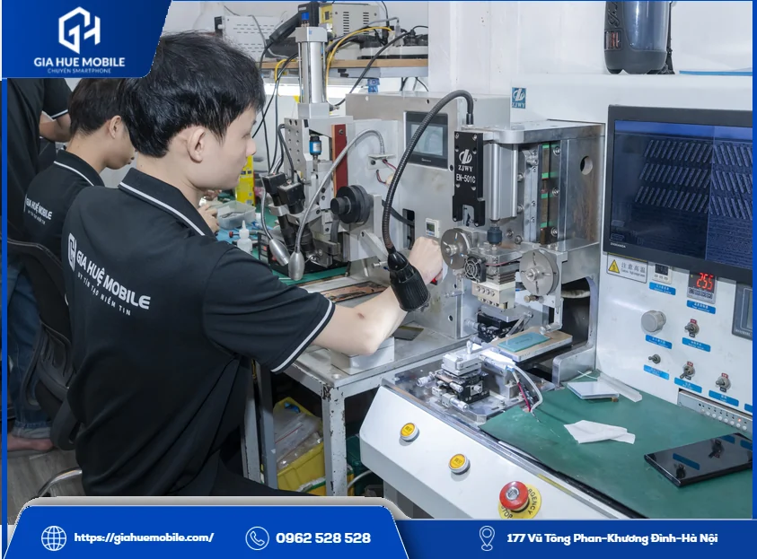
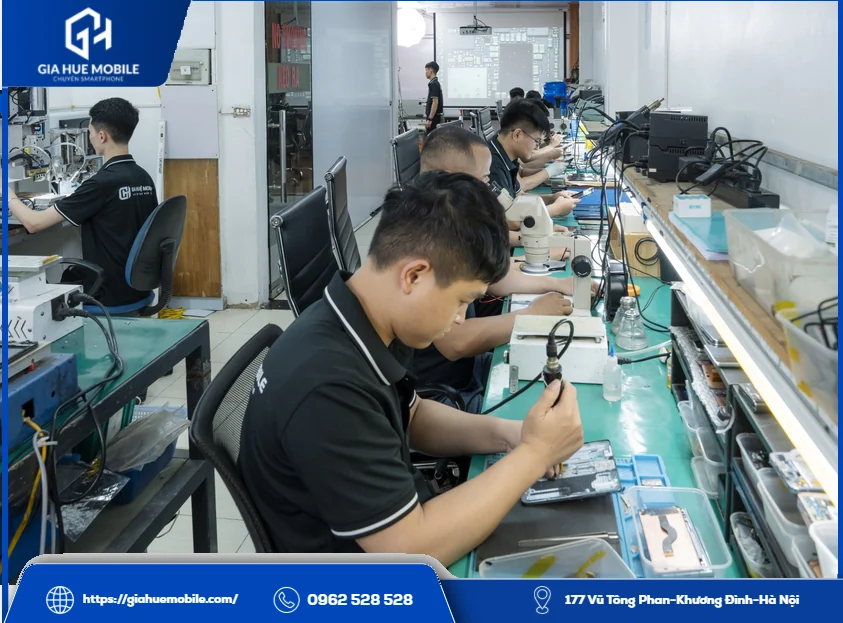
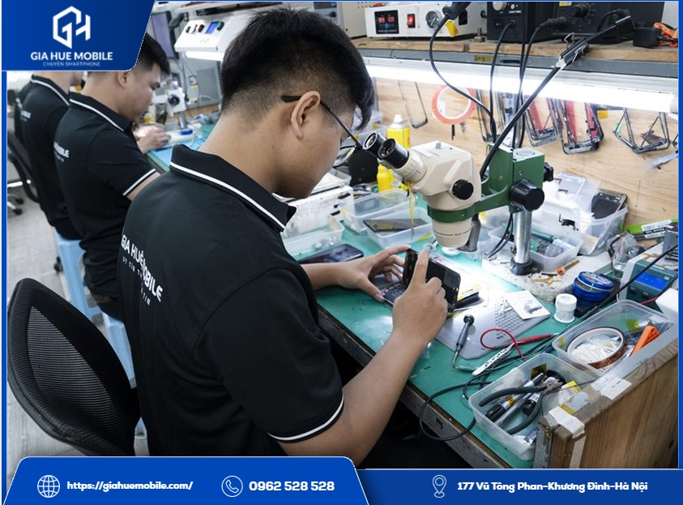
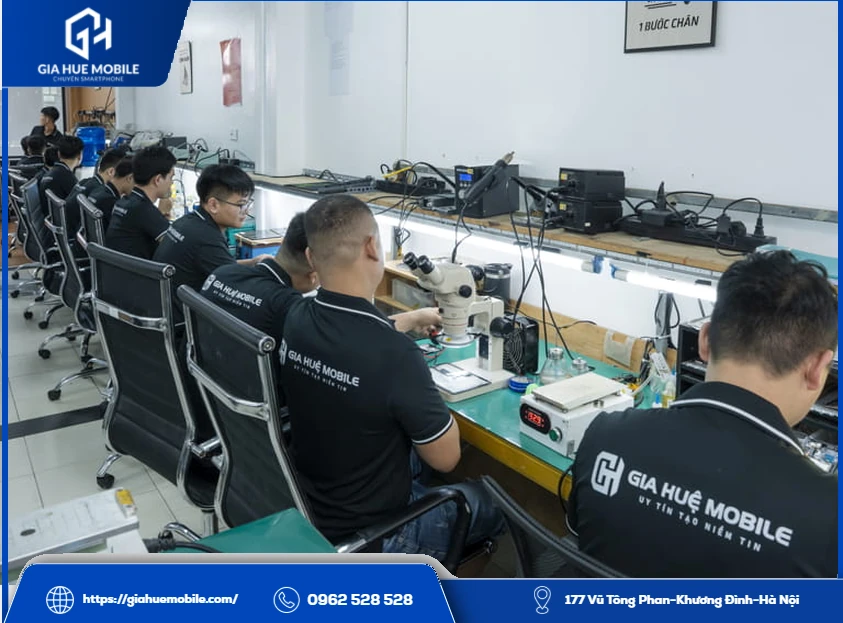

# Thay màn hình OPPO Reno 7 Pro

**Thay màn hình OPPO Reno 7 Pro** tại **Gia Huệ Mobile** mất khoảng 45–60 phút, luôn có sẵn linh kiện, dữ liệu vẫn giữ nguyên, bảo hành lỗi cảm ứng 1 đổi 1 trong 6 tháng. Máy vỡ màn, sọc, chảy mực hay liệt cảm ứng thì nên kiểm tra miễn phí trước, vì không phải lỗi nào cũng phải thay.

*Kỹ thuật viên kiểm tra tình trạng điện thoại tại bàn kính hiển vi của Gia Huệ Mobile*

## 1. Vừa làm rơi vỡ màn Reno 7 Pro thì làm gì trước?

Việc đầu tiên là giữ dữ liệu, chưa cần vội đi thay màn hình OPPO Reno 7 Pro ngay.
- **Sao lưu ngay:** màn còn lên hình thì chép ảnh, danh bạ sang nơi khác, vì vết nứt có thể lan và mất hiển thị bất cứ lúc nào.
- **Dừng vuốt mạnh lên chỗ vỡ:** mảnh kính dễ làm xước tay và hỏng thêm cảm ứng.
- **Tránh nước và hơi ẩm:** kính đã nứt thì khe hở mở ra, đừng để máy trong phòng tắm hay chỗ ẩm.
- **Nhớ lại lúc hỏng:** máy rơi hay vào nước thì báo cho kỹ thuật viên, tìm lỗi sẽ nhanh hơn.

## 2. Màn gồm ba lớp, hỏng lớp nào thì xử lý khác nhau

Cụm màn có lớp kính ngoài, lớp cảm ứng và tấm nền hiển thị. Biết lỗi nằm ở lớp nào thì biết có phải thay cả cụm hay không.

### Hỏng lớp kính ngoài

Kính rạn nhưng hình vẫn nét, chạm vẫn ăn. Trường hợp này có thể ép kính, chưa cần thay màn.

### Hỏng cảm ứng

Máy tự bấm, loạn, có vùng chạm không ăn. Thường phải thay cả cụm màn, nhưng cần kiểm tra trước vì đôi khi do cáp.

### Hỏng tấm nền

Mảng đen, vệt mực lan dần, mất hiển thị nhiều vùng. Đây là lúc phải thay. Riêng sọc hay nháy khi tấm nền không nứt thì còn có thể ép cáp, xem thêm [lỗi nhiễu màn hình OPPO không cần thay màn](https://giahuemobile.com/loi-nhieu-man-hinh-oppo/).

*Máy ép cáp tại Gia Huệ Mobile, dùng khi lỗi nằm ở cáp và chưa cần thay màn hình OPPO Reno 7 Pro*

## 3. Chi phí và thời gian thay màn hình OPPO Reno 7 Pro

Giá báo trọn gói theo đợt nhập linh kiện, bạn gọi **0962 528 528** để biết con số đúng lúc đó.
| Hạng mục | Thông tin |
|---|---|
| Giá | **Liên hệ** |
| Thời gian | Khoảng 45–60 phút, luôn có sẵn linh kiện |
| Bảo hành | Lỗi cảm ứng 1 đổi 1 trong 6 tháng |
| Không bảo hành | Màn vỡ, cấn bể, chảy mực, loang màu, vào nước sau khi sửa |
Điều kiện đầy đủ xem tại [chính sách bảo hành](https://giahuemobile.com/chinh-sach-bao-hanh/).

*Bàn kỹ thuật của Gia Huệ Mobile, nơi kiểm tra linh kiện trước khi thay màn hình OPPO Reno 7 Pro*

## 4. Bạn nhận được gì khi sửa tại Gia Huệ Mobile

Bạn thấy rõ máy mình được làm gì và trả tiền cho việc gì.
- **Keo mới:** khách được dán đầy đủ keo tếp kháng nước, giúp màn bám chắc, hạn chế bụi và hơi ẩm.
- **Linh kiện có tên bạn:** ký tên lên màn mới, nhận lại màn cũ.
- **Không tự làm thêm:** có lỗi khác thì **Gia Huệ Mobile** báo trước, bạn đồng ý mới làm.
- **Miễn phí:** kiểm tra máy và vệ sinh máy.
Xưởng làm nghề 22 năm, có kính hiển vi và máy ép cáp nên sửa được là bên mình tư vấn sửa.

*Kỹ thuật viên tháo lắp màn hình điện thoại trên thảm chống tĩnh điện tại Gia Huệ Mobile*

## 5. Các bước thay màn hình OPPO Reno 7 Pro tại bàn kỹ thuật

1. Kiểm tra máy cùng bạn và ghi lên phiếu.
2. Báo lỗi, báo giá, bạn đồng ý mới làm.
3. Làm mềm keo, tách màn cũ, vệ sinh khung.
4. Cắm màn mới, thử hiển thị và cảm ứng.
5. Lắp cố định, dán keo.
6. Thử lại lần cuối, kích hoạt bảo hành điện tử.

## 6. Câu hỏi về việc thay màn hình OPPO Reno 7 Pro

### Màn đen hẳn thì còn lấy được ảnh không?

Thường còn, vì ảnh nằm trong bộ nhớ chứ không nằm ở màn. Thay màn xong máy lên hình là dùng lại được.

### Nên ép kính hay thay luôn cho khỏe?

Hình đẹp, cảm ứng đều thì nên xem xét ép kính. Tấm nền đã nứt thì ép kính không giải quyết được.

### Thay màn hình OPPO Reno 7 Pro giá bao nhiêu?

Bạn gọi 0962 528 528 để nhận báo giá trọn gói theo thời điểm.

### Tôi có phải để máy lại không?

Nếu máy không có lỗi đi kèm, bạn ngồi đợi khoảng 45–60 phút.

### Có được xem thợ làm không?

Có. Bạn ngồi xem trực tiếp tại bàn kỹ thuật.

### Thay xong đi mưa được không?

Không nên chủ quan. Keo mới giúp hạn chế hơi ẩm, nhưng máy đã tháo ra sửa thì vẫn nên tránh nước.

## 7. Mang máy tới đâu?

*Khu kỹ thuật của Gia Huệ Mobile, nơi nhận thay màn hình OPPO Reno 7 Pro tại Hà Nội*

**Cơ sở 1:** [177 Vũ Tông Phan, Khương Đình, Thanh Xuân, Hà Nội](https://www.google.com/maps/search/?api=1&query=Gia+Huệ+Mobile+177+Vũ+Tông+Phan+Khương+Đình+Thanh+Xuân+Hà+Nội) · Hotline **0962 528 528**

**Cơ sở 2:** [22 Thái Hà, Trung Liệt, Đống Đa, Hà Nội](https://www.google.com/maps/search/?api=1&query=Gia+Huệ+Mobile+22+Thái+Hà+Trung+Liệt+Đống+Đa+Hà+Nội) · Hotline **0986 980 802**
Cửa hàng luôn có sẵn linh kiện, bạn có thể gọi trước để được tư vấn khi cần **thay màn hình OPPO Reno 7 Pro**.
**Xem thêm:** [Thay màn hình OPPO Reno 7](https://giahuemobile.com/san-pham/thay-man-hinh-oppo-reno-7/) · [Thay màn hình OPPO Reno 8 Pro](https://giahuemobile.com/san-pham/thay-man-hinh-oppo-reno-8-pro/) · [Thay kính OPPO](https://giahuemobile.com/danh-muc-san-pham/sua-dien-thoai-oppo/thay-kinh-oppo/) · [Thay màn hình OPPO](https://giahuemobile.com/danh-muc-san-pham/sua-dien-thoai-oppo/thay-man-hinh-oppo/) · [Trang chủ Gia Huệ Mobile](https://giahuemobile.com/)
