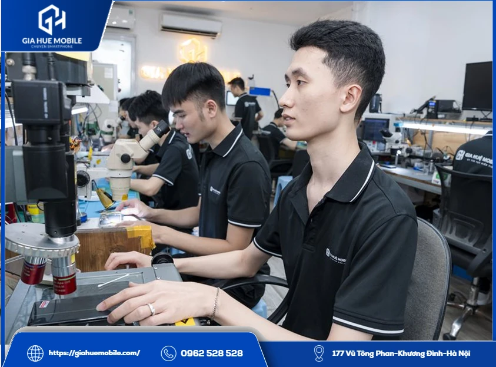
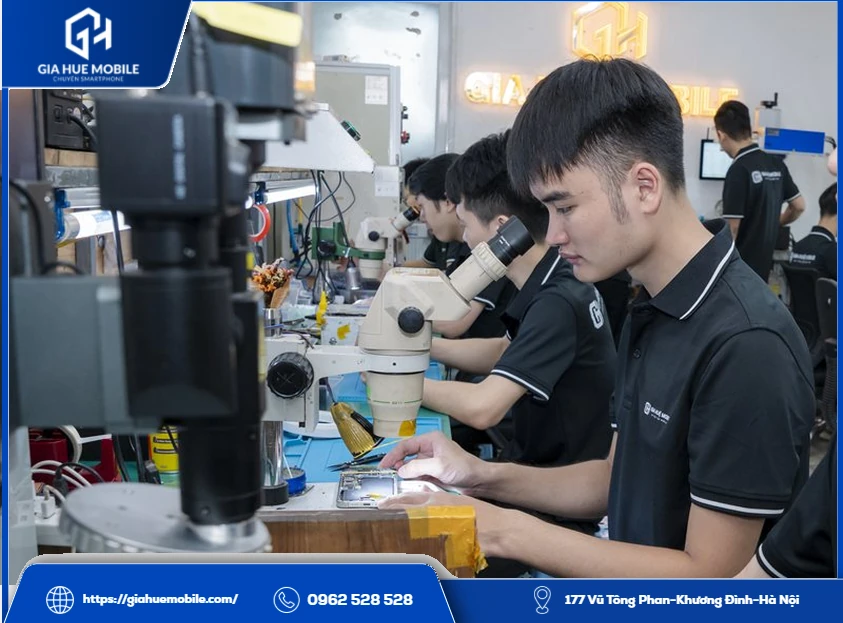
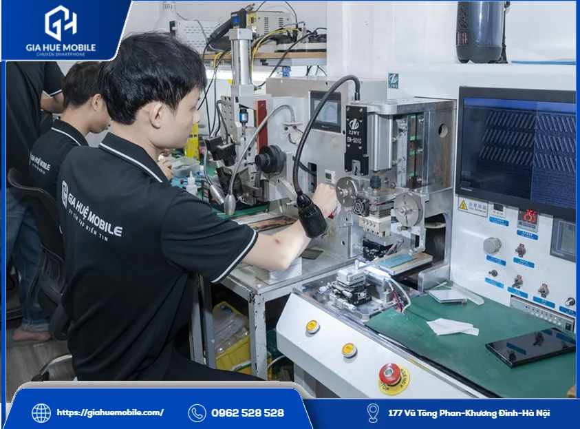
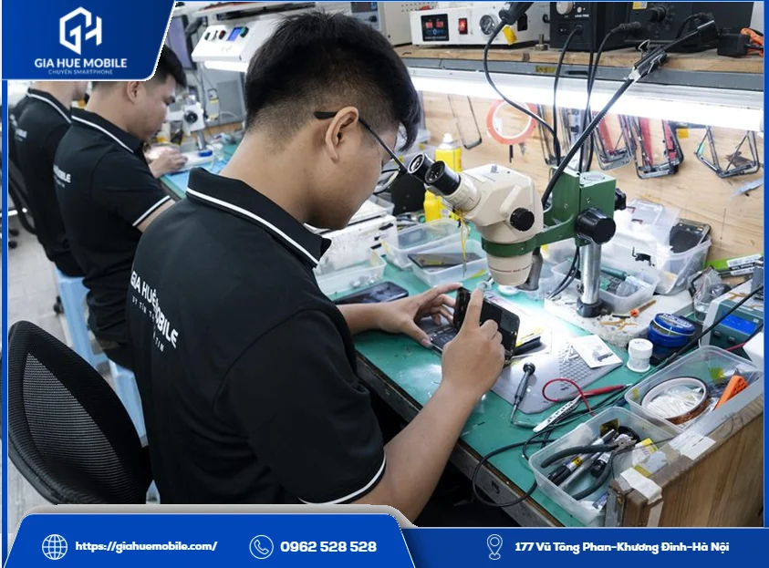
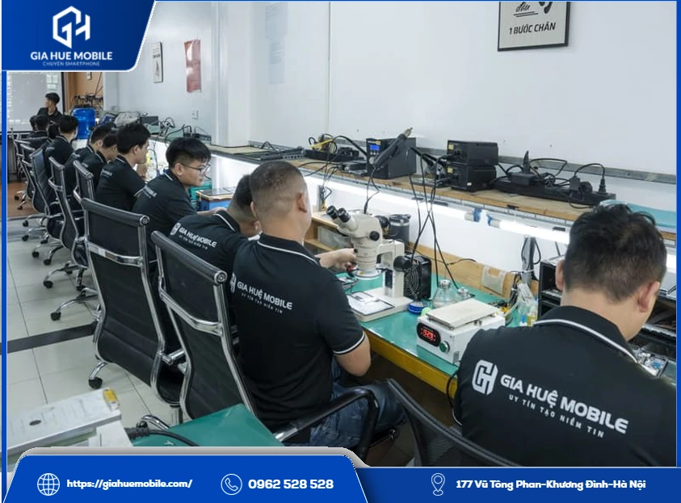

# Thay màn hình OPPO Reno 8 Pro

**Thay màn hình OPPO Reno 8 Pro** tại **Gia Huệ Mobile** mất khoảng 60–90 phút, luôn có sẵn linh kiện, dữ liệu vẫn giữ nguyên, bảo hành lỗi cảm ứng 1 đổi 1 trong 6 tháng. Bên mình có Màn Zin và Màn Cao Cấp; chỉ cần thay cả màn khi tấm nền hoặc cảm ứng đã hỏng.

*Kỹ thuật viên Gia Huệ Mobile kiểm tra máy trước khi thay màn hình OPPO Reno 8 Pro*

## 1. Màn Zin hay Màn Cao Cấp cho OPPO Reno 8 Pro?

Muốn giữ đúng hiển thị gốc thì chọn Màn Zin. Cả hai loại đều cùng thời gian làm và cùng mức bảo hành, nên khác nhau chủ yếu ở giá và nhu cầu của bạn.
| So sánh | Màn Zin | Màn Cao Cấp |
|---|---|---|
| Hiển thị | Chuẩn hiển thị gốc | Sắc nét |
| Cảm ứng | Mượt, ổn định lâu dài | Nhạy |
| Thời gian | 60–90 phút | 60–90 phút |
| Bảo hành | 6 tháng | 6 tháng |
| Giá | **Liên hệ** | **Liên hệ** |

### Khi nào nên chọn Màn Zin?

Khi bạn hay xem phim, chỉnh ảnh, hoặc định dùng máy thêm lâu dài. Màn này được ghi là hỗ trợ đủ 120Hz và HDR10+.

### Khi nào Màn Cao Cấp là đủ?

Khi bạn dùng máy cho nhu cầu thường ngày và muốn cân đối chi phí. Bạn gọi **0962 528 528** để so giá hai loại theo thời điểm rồi mới quyết.

## 2. Màn Reno 8 Pro có gì phải thử sau khi lắp?

Máy dùng [màn hình AMOLED](https://vi.wikipedia.org/wiki/AMOLED) phẳng 6,7 inch, độ phân giải 2412×1080, tần số quét 120Hz, HDR10+ và vân tay dưới màn, nên có ba thứ cần thử lại.
- **Màu:** so nền trắng, nền đen, xem có ám hay loang không.
- **Vuốt:** rê tay khắp màn ở 120Hz, không được khựng hay mất điểm.
- **Vân tay:** đăng ký lại và mở khóa vài lần.

*Soi kính hiển vi để xác định lỗi trước khi thay màn hình OPPO Reno 8 Pro*

## 3. Trường hợp chưa cần thay màn hình OPPO Reno 8 Pro

Chưa cần khi tấm nền và cảm ứng còn tốt. Bên mình luôn kiểm tra miễn phí trước để tránh bạn tốn tiền không đáng.
- **Vỡ kính, hình vẫn nét:** có thể ép kính, xem dịch vụ [thay kính OPPO](https://giahuemobile.com/danh-muc-san-pham/sua-dien-thoai-oppo/thay-kinh-oppo/).
- **Sọc, nháy, tấm nền không nứt:** có thể do cáp, xử lý bằng máy ép cáp.
Ngược lại, máy bị loang mực, điểm chết lan rộng, tối đen hoặc liệt cảm ứng thì thường phải thay. Lỗi này hay gặp sau khi rơi máy, bị đè trong balo hoặc vào nước.

*Máy ép cáp tại Gia Huệ Mobile, dùng khi lỗi nằm ở cáp và chưa cần thay màn hình OPPO Reno 8 Pro*

## 4. Thay màn hình OPPO Reno 8 Pro tại Gia Huệ Mobile có gì?

Giá báo trọn gói trước khi làm, không phát sinh chi phí, và bạn ngồi xem được từ đầu đến cuối.
**Trước khi làm:** kiểm tra máy trước mặt bạn, hai bên ký phiếu tình trạng, chốt loại màn và giá.
**Trong lúc làm:** tách màn cũ, vệ sinh khung, cắm thử màn mới rồi mới lắp. Khách được dán đầy đủ keo tếp kháng nước quanh viền.
**Khi nhận máy:** gọi thử, mở camera, ký tên lên linh kiện đã thay, nhận lại màn cũ và kích hoạt bảo hành điện tử theo số điện thoại.
**Gia Huệ Mobile** có 22 năm làm nghề, phát hiện lỗi khác thì báo trước. Bảo hành áp dụng cho lỗi cảm ứng, không áp dụng khi màn vỡ, chảy mực hoặc vào nước sau khi nhận máy, chi tiết ở [chính sách bảo hành](https://giahuemobile.com/chinh-sach-bao-hanh/).

*Tháo lắp linh kiện tại bàn kỹ thuật, một bước khi thay màn hình OPPO Reno 8 Pro*

## 5. Hỏi đáp nhanh khi thay màn hình OPPO Reno 8 Pro

### Giá hai loại màn chênh nhau bao nhiêu?

Giá đổi theo đợt nhập, bạn gọi 0962 528 528 để được báo cả hai loại.

### Chọn Màn Cao Cấp có mất vân tay không?

Vân tay phụ thuộc vào độ tương thích của màn, nên bên mình thử trước khi dán keo. Bạn cứ hỏi rõ khi chọn loại màn.

### Có mất dữ liệu không?

Không, vì thay màn không động tới bộ nhớ. Bạn vẫn nên sao lưu nếu máy còn thao tác được.

### Reno 8 Pro và Reno 8 Pro Plus có dùng chung màn không?

Đừng tự suy ra là dùng chung. Hãy báo đúng tên máy để bên mình đối chiếu.

### Khi nào nên ép kính thay vì thay màn?

Khi chỉ vỡ kính, hình đẹp, cảm ứng đều và máy đủ điều kiện tách kính.

### Thay xong dùng dưới nước được không?

Không nên. Keo mới chỉ giúp hạn chế bụi và hơi ẩm.

## 6. Địa chỉ nhận thay màn tại Hà Nội

*Khu kỹ thuật của Gia Huệ Mobile, nơi nhận thay màn hình OPPO Reno 8 Pro tại Hà Nội*

**Cơ sở 1:** [177 Vũ Tông Phan, Khương Đình, Thanh Xuân, Hà Nội](https://www.google.com/maps/search/?api=1&query=Gia+Huệ+Mobile+177+Vũ+Tông+Phan+Khương+Đình+Thanh+Xuân+Hà+Nội) · Hotline **0962 528 528**

**Cơ sở 2:** [22 Thái Hà, Trung Liệt, Đống Đa, Hà Nội](https://www.google.com/maps/search/?api=1&query=Gia+Huệ+Mobile+22+Thái+Hà+Trung+Liệt+Đống+Đa+Hà+Nội) · Hotline **0986 980 802**
Chưa biết chọn loại màn nào, bạn mang máy qua để xem cả hai trước khi **thay màn hình OPPO Reno 8 Pro**.
**Liên quan:** [Thay pin OPPO Reno 8 Pro](https://giahuemobile.com/san-pham/thay-pin-oppo-reno-8-pro/) · [Thay màn hình OPPO Reno 8](https://giahuemobile.com/san-pham/thay-man-hinh-oppo-reno-8/) · [Thay màn hình OPPO Reno 7 Pro](https://giahuemobile.com/san-pham/thay-man-hinh-oppo-reno-7-pro/) · [Thay màn hình OPPO](https://giahuemobile.com/danh-muc-san-pham/sua-dien-thoai-oppo/thay-man-hinh-oppo/) · [Trang chủ Gia Huệ Mobile](https://giahuemobile.com/)
