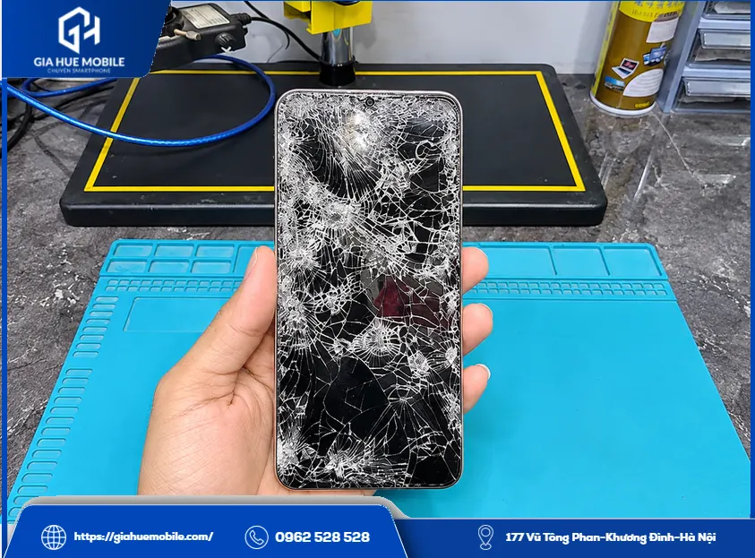
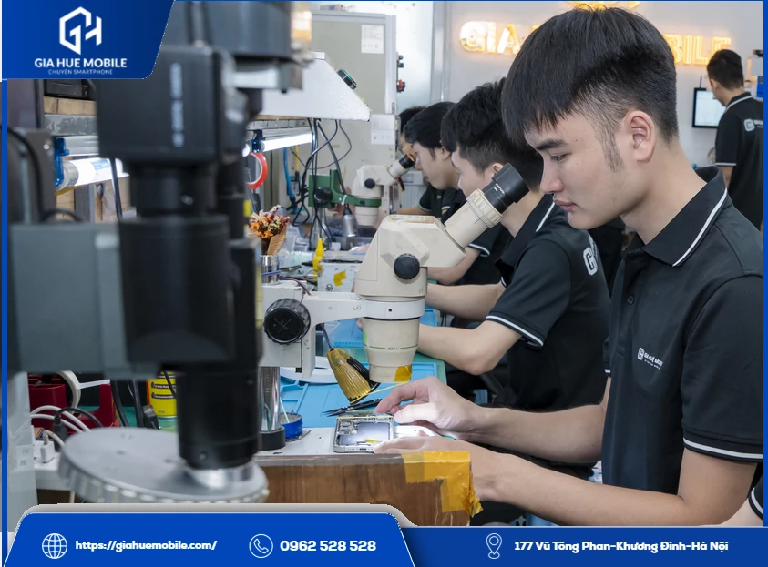
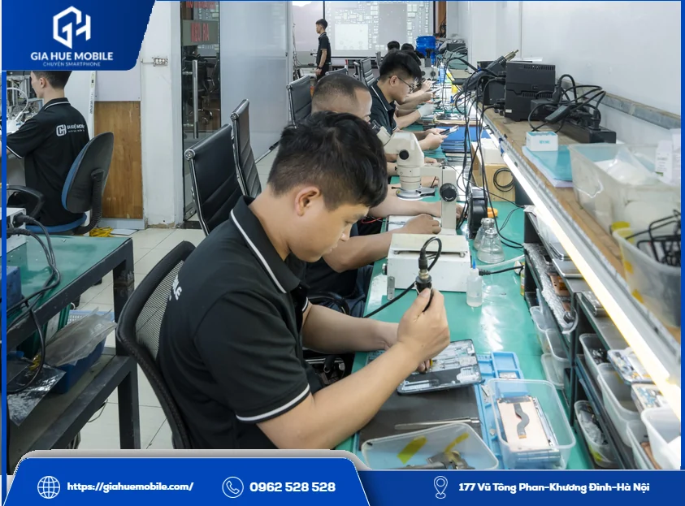
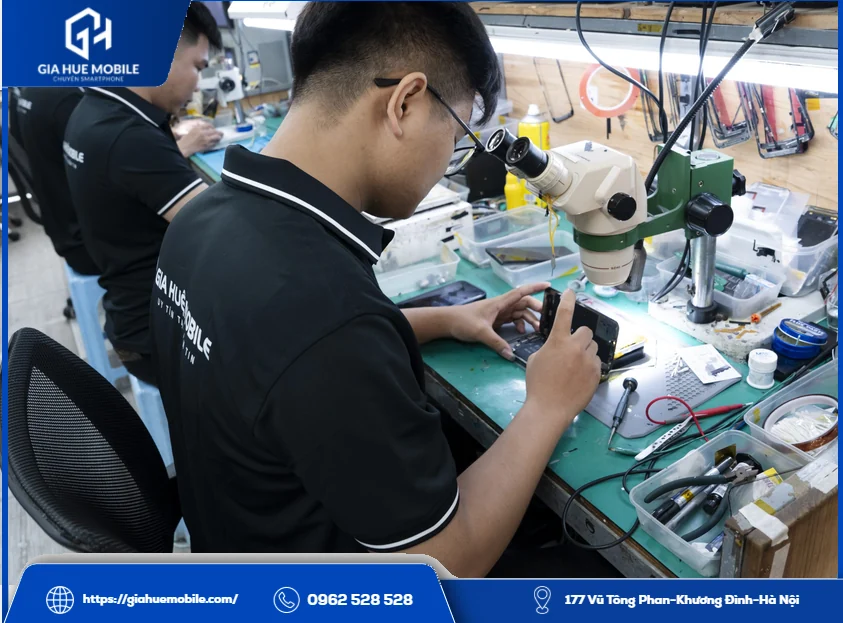
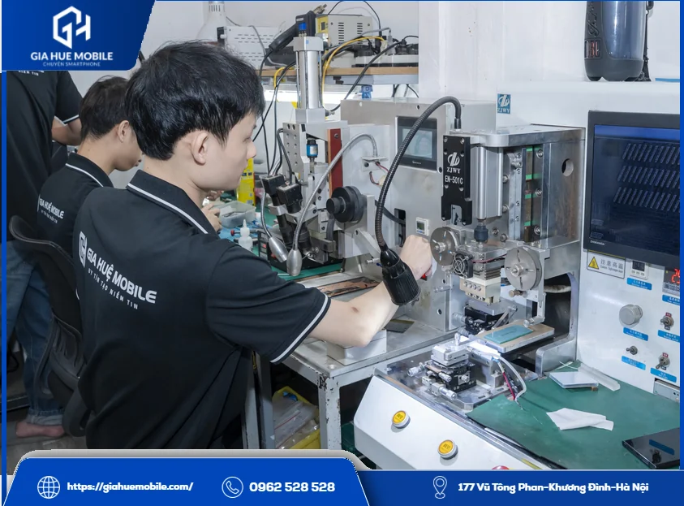

# Thay màn hình Vivo S16

**Thay màn hình Vivo S16** tại **Gia Huệ Mobile** mất khoảng 60–90 phút, luôn có sẵn linh kiện, dữ liệu vẫn còn nguyên, bảo hành lỗi cảm ứng 1 đổi 1 trong 6 tháng. Đây là màn cong nên khâu tách màn và dán keo cần làm kỹ hơn màn phẳng; máy nên được kiểm tra miễn phí trước khi quyết định.

*Điện thoại vỡ kính nặng, tình trạng cần kiểm tra trước khi thay màn hình Vivo S16*

## 1. Màn cong của Vivo S16 khó hơn màn phẳng ở đâu?

Vivo S16 dùng [màn hình AMOLED](https://vi.wikipedia.org/wiki/AMOLED) cong 6,78 inch, 2400×1080, 120Hz, có vân tay dưới màn. Phần khó nằm ở hai cạnh cong xuống.

### Lúc tách màn cũ

Keo bám theo đường cong nên phải làm mềm đều từng đoạn. Nóng không đều hoặc nạy mạnh, viền rất dễ nứt và khung dễ xước.

### Lúc đặt màn mới

Hai cạnh cong phải khớp với khung, lệch một chút là thấy hở sáng hoặc cấn viền.

### Lúc dán keo

Keo phải đi đều theo cạnh cong. Khách được dán đầy đủ keo tếp kháng nước quanh viền, giúp màn bám chắc và hạn chế bụi, hơi ẩm.

*Soi kính hiển vi để xác định lỗi trước khi thay màn hình Vivo S16*

## 2. Vỡ kính màn cong có ép được không?

Có thể, nếu hiển thị và cảm ứng còn tốt, nhưng rủi ro cao hơn màn phẳng nên phải xem máy trước. Đọc thêm [ép kính màn cong Vivo có dễ hỏng màn không](https://giahuemobile.com/ep-kinh-man-cong-vivo-v30-5g-co-de-hong-man-khong/).
Khi nào thì nên **thay màn hình Vivo S16** thay vì ép kính? Xem ba mức sau:
| Mức độ | Biểu hiện | Thường xử lý |
|---|---|---|
| Nhẹ | Nứt kính, hình đẹp, chạm vẫn ăn | Xem xét ép kính |
| Vừa | Sọc, nhiễu, tấm nền không nứt | Kiểm tra cáp màn |
| Nặng | Chảy mực, không lên hình, liệt cảm ứng | Thay màn |
Máy hay hỏng màn sau khi rơi, bị đè trong túi, balo hoặc vào nước. Từng thay màn kém chất lượng cũng dễ sinh lỗi.

## 3. Giá và bảo hành khi thay màn hình Vivo S16

Bạn gọi hoặc nhắn Zalo **0962 528 528** để nhận giá trọn gói. Hiện bài ghi **Liên hệ** vì giá màn đổi theo đợt nhập.
Loại màn là Màn Zin, làm khoảng 60–90 phút nếu máy không có lỗi đi kèm. Bảo hành lỗi cảm ứng 1 đổi 1 trong 6 tháng, tra bằng số điện thoại; màn bị vỡ, cấn, chảy mực hay vào nước sau khi nhận máy thì không thuộc [chính sách bảo hành](https://giahuemobile.com/chinh-sach-bao-hanh/).

*Bàn kỹ thuật của Gia Huệ Mobile, nơi kiểm tra linh kiện trước khi báo giá thay màn hình Vivo S16*

## 4. Vì sao nên để thợ quen màn cong làm?

Vì màn cong sai một bước là tốn thêm một cái màn. Tại **Gia Huệ Mobile**, sau 22 năm làm nghề, việc thay màn được làm trước mặt bạn.
- Hai bên kiểm tra máy và ký phiếu tình trạng trước khi mở máy.
- Báo rõ lỗi và giá, bạn gật đầu mới làm.
- Cắm thử màn mới, xem hiển thị, cảm ứng, vân tay rồi mới dán.
- Bạn ký tên lên linh kiện, nhận lại màn cũ.
- Trước khi giao máy, gọi thử, mở camera, kích hoạt bảo hành điện tử.
Kiểm tra và vệ sinh máy đều miễn phí, có xuất hóa đơn VAT, hoàn tiền theo chính sách khi lỗi thuộc về cửa hàng.

*Kỹ thuật viên thao tác tại bàn kỹ thuật, một bước khi thay màn hình Vivo S16*

## 5. Thắc mắc khi thay màn hình Vivo S16

### Tự thay màn cong ở nhà được không?

Không nên. Màn cong dễ nứt viền khi tách, và màn mới dễ hở cạnh nếu dán không đều.

### Màn mới có bị hở viền không?

Nếu màn đúng loại và dán đều thì không. Bạn kiểm tra hai cạnh khi nhận máy, thấy hở thì báo ngay.

### Vivo S16, S16 Pro và S16e có dùng chung màn không?

Bạn đừng tự suy ra là dùng chung. Hãy báo đúng tên máy để bên mình đối chiếu.

### Máy lên hình nhưng vân tay không nhận thì sao?

Bên mình thử vân tay trước khi dán keo. Sau khi thay, nếu nhận chậm thì bạn xóa đi đăng ký lại.

### Có mất dữ liệu không?

Không, thay màn không động tới bộ nhớ.

### Thay xong có đi bơi được không?

Không nên. Keo mới giúp hạn chế hơi ẩm, không phải để dùng dưới nước.

## 6. Gia Huệ Mobile ở đâu?

*Máy móc tại khu kỹ thuật của Gia Huệ Mobile, nơi nhận thay màn hình Vivo S16 tại Hà Nội*

**Cơ sở 1:** [177 Vũ Tông Phan, Khương Đình, Thanh Xuân, Hà Nội](https://www.google.com/maps/search/?api=1&query=Gia+Huệ+Mobile+177+Vũ+Tông+Phan+Khương+Đình+Thanh+Xuân+Hà+Nội) · Hotline **0962 528 528**

**Cơ sở 2:** [22 Thái Hà, Trung Liệt, Đống Đa, Hà Nội](https://www.google.com/maps/search/?api=1&query=Gia+Huệ+Mobile+22+Thái+Hà+Trung+Liệt+Đống+Đa+Hà+Nội) · Hotline **0986 980 802**
Màn cong đang nứt thì nên đi sớm, vết nứt lan càng rộng càng khó còn lựa chọn khác ngoài **thay màn hình Vivo S16**.
**Dịch vụ khác:** [Thay pin Vivo S16](https://giahuemobile.com/san-pham/thay-pin-vivo-s16/) · [Thay kính Vivo](https://giahuemobile.com/danh-muc-san-pham/sua-dien-thoai-vivo/thay-kinh-vivo/) · [Thay màn hình Vivo V29](https://giahuemobile.com/san-pham/thay-man-hinh-vivo-v29/) · [Thay màn hình Vivo](https://giahuemobile.com/danh-muc-san-pham/sua-dien-thoai-vivo/thay-man-hinh-vivo/) · [Trang chủ Gia Huệ Mobile](https://giahuemobile.com/)
