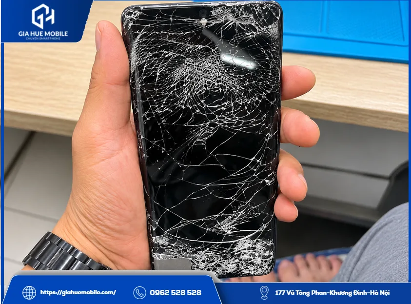
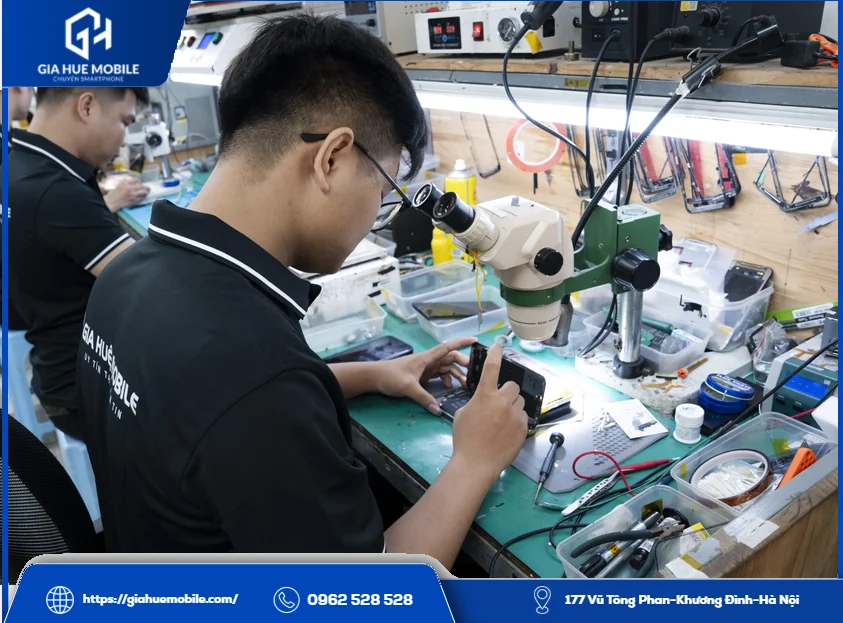
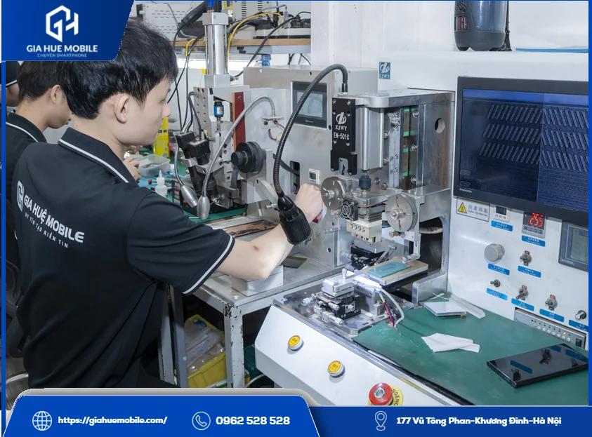
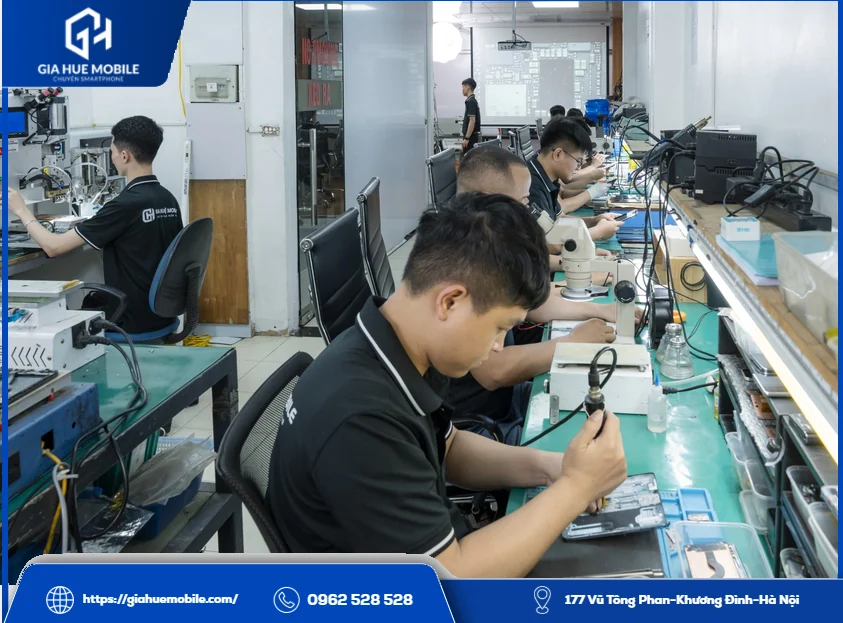
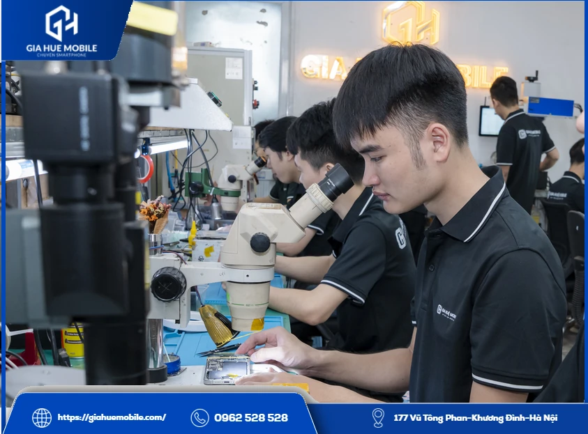

# Thay màn hình Vivo S17

**Thay màn hình Vivo S17** tại **Gia Huệ Mobile** mất khoảng 60–90 phút, luôn có sẵn linh kiện, ảnh và dữ liệu vẫn còn nguyên, bảo hành lỗi cảm ứng 1 đổi 1 trong 6 tháng. Trước khi thay, kỹ thuật viên đối chiếu đúng đời máy và kiểm tra miễn phí xem có thật sự cần thay cả màn.

*Màn hình vỡ kính nhiều vết nứt, tình trạng cần kiểm tra trước khi thay màn hình Vivo S17*

## 1. Máy của tôi là S17, S17 Pro, S17t hay S17e?

Vào Cài đặt, mục thông tin điện thoại là thấy tên máy. Màn đen không xem được thì nhìn hộp máy, hoặc để kỹ thuật viên kiểm tra giúp.
Tên gần giống nhau nên khách hay nhầm, và nhầm tên thì báo giá, đặt màn đều sai. Đó là lý do bên mình luôn hỏi đúng đời máy đầu tiên.

## 2. Màn các máy S17 có lắp lẫn được không?

Đừng tự suy ra là được. S17, S17 Pro và S17t được công bố cùng thông số [màn hình AMOLED](https://vi.wikipedia.org/wiki/AMOLED) 6,78 inch, 2800×1260, 120Hz, còn S17e thì chưa chắc giống. Cùng thông số vẫn phải đối chiếu vị trí cáp và khung máy trên máy thật.

*Kính hiển vi tại xưởng Gia Huệ Mobile, dùng để soi lỗi trước khi thay màn hình Vivo S17*

## 3. Lỗi thế nào thì phải thay màn hình Vivo S17?

Phải thay khi tấm nền đã nứt hoặc cảm ứng liệt nặng. Còn lại nên kiểm tra trước.
**Thường phải thay:** vết đen hoặc mực loang to dần, mất hình, máy vẫn đổ chuông nhưng màn đen, cảm ứng tự bấm khắp màn.
**Có thể chưa phải thay:** kính vỡ mà hình vẫn đẹp thì xem xét ép kính; sọc hay nháy khi tấm nền không nứt thì kiểm tra cáp màn.
Phần lớn các lỗi này đến sau một lần rơi, bị đè hoặc vào nước.

*Máy ép cáp tại Gia Huệ Mobile, dùng khi lỗi nằm ở cáp và chưa cần thay màn hình Vivo S17*

## 4. Thay màn hình Vivo S17 hết bao nhiêu, bao lâu?

Giá **Liên hệ**, làm khoảng 60–90 phút nếu máy không có lỗi đi kèm.
| Bạn hỏi | Bên mình trả lời |
|---|---|
| Loại màn | Màn Zin |
| Giá | Gọi **0962 528 528**, báo đúng tên máy, nhận giá trọn gói |
| Phát sinh | Không phát sinh sau khi đã báo giá |
| Bảo hành | Cảm ứng 1 đổi 1 trong 6 tháng, tra bằng số điện thoại |
Màn vỡ, cấn, chảy mực, vào nước sau khi nhận máy thì nằm ngoài [chính sách bảo hành](https://giahuemobile.com/chinh-sach-bao-hanh/).

## 5. Mang máy tới thì bên mình làm gì?

Bên mình đối chiếu máy trước, rồi mới mở máy khi bạn đã đồng ý giá.
1. Xem tình trạng cùng bạn, hai bên ký phiếu.
2. Xác định đúng đời máy, nói rõ lỗi và giá.
3. Làm mềm keo, tháo màn cũ, vệ sinh khung.
4. Cắm thử màn mới: lên hình đều, chạm ăn khắp màn, chạy mượt.
5. Lắp cố định, dán đầy đủ keo tếp kháng nước.
6. Gọi thử, mở camera, kích hoạt bảo hành điện tử.
Trong lúc làm, bạn được ngồi xem, ký tên lên linh kiện và nhận lại màn cũ. **Gia Huệ Mobile** có 22 năm làm nghề, kiểm tra và vệ sinh máy miễn phí, có hỗ trợ xuất hóa đơn VAT, hoàn tiền theo chính sách khi lỗi thuộc về cửa hàng.

*Kỹ thuật viên làm việc tại xưởng, nơi thực hiện việc thay màn hình Vivo S17*

## 6. Còn câu hỏi nào về thay màn hình Vivo S17?

### Tôi nhớ nhầm tên máy thì có sao không?

Không sao, chỉ cần mang máy qua, bên mình xem trực tiếp. Gọi hỏi trước thì nên đọc đúng tên trong Cài đặt.

### Máy S17e có thay được ở đây không?

Bạn báo riêng tên máy để cửa hàng tra đúng loại màn.

### Thay màn có ảnh hưởng mở khóa vân tay không?

Nên kiểm tra sau khi lắp vì vân tay phụ thuộc vào độ tương thích của màn. Đọc thêm [thay màn hình Vivo X80 Pro có mất vân tay không](https://giahuemobile.com/thay-man-hinh-vivo-x80-pro-co-mat-van-tay-khong/).

### Dữ liệu có còn không?

Còn, vì việc thay màn không động tới bộ nhớ. Máy còn dùng được thì bạn vẫn nên sao lưu.

### Có giữ được kháng nước không?

Keo mới giúp hạn chế hơi ẩm, nhưng máy đã tháo ra sửa thì bạn nên tránh nước.

### Có cần gọi trước khi mang máy đến không?

Không bắt buộc, vì cửa hàng luôn có sẵn linh kiện. Bạn gọi trước nếu muốn được tư vấn kỹ hơn.

## 7. Hai cơ sở nhận máy tại Hà Nội

*Khu bàn kỹ thuật của Gia Huệ Mobile, nơi nhận thay màn hình Vivo S17 tại Hà Nội*

**Cơ sở 1:** [177 Vũ Tông Phan, Khương Đình, Thanh Xuân, Hà Nội](https://www.google.com/maps/search/?api=1&query=Gia+Huệ+Mobile+177+Vũ+Tông+Phan+Khương+Đình+Thanh+Xuân+Hà+Nội) · Hotline **0962 528 528**

**Cơ sở 2:** [22 Thái Hà, Trung Liệt, Đống Đa, Hà Nội](https://www.google.com/maps/search/?api=1&query=Gia+Huệ+Mobile+22+Thái+Hà+Trung+Liệt+Đống+Đa+Hà+Nội) · Hotline **0986 980 802**
Chỉ cần đọc đúng tên máy khi gọi, việc **thay màn hình Vivo S17** sẽ nhanh hơn nhiều.
**Bạn có thể xem:** [Thay màn hình Vivo S19](https://giahuemobile.com/san-pham/thay-man-hinh-vivo-s19/) · [Thay màn hình Vivo S16](https://giahuemobile.com/san-pham/thay-man-hinh-vivo-s16/) · [Thay kính Vivo](https://giahuemobile.com/danh-muc-san-pham/sua-dien-thoai-vivo/thay-kinh-vivo/) · [Thay màn hình Vivo](https://giahuemobile.com/danh-muc-san-pham/sua-dien-thoai-vivo/thay-man-hinh-vivo/) · [Trang chủ Gia Huệ Mobile](https://giahuemobile.com/)
