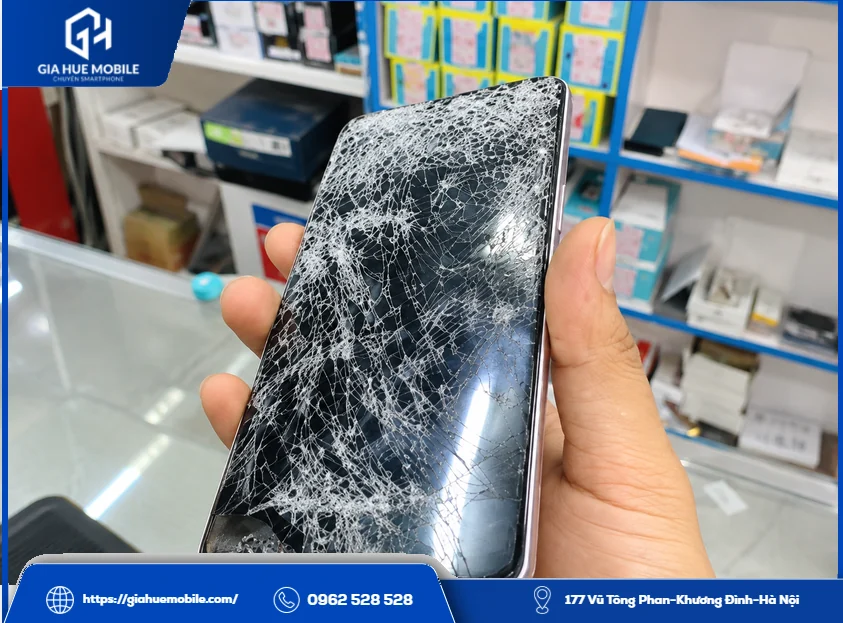
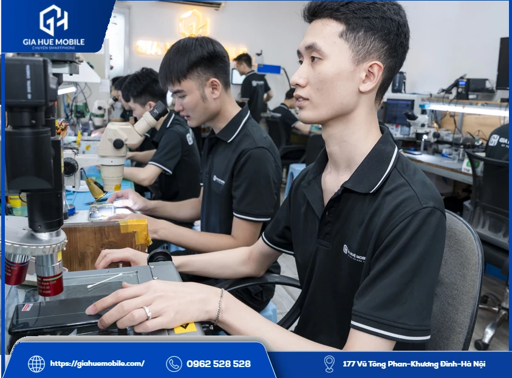
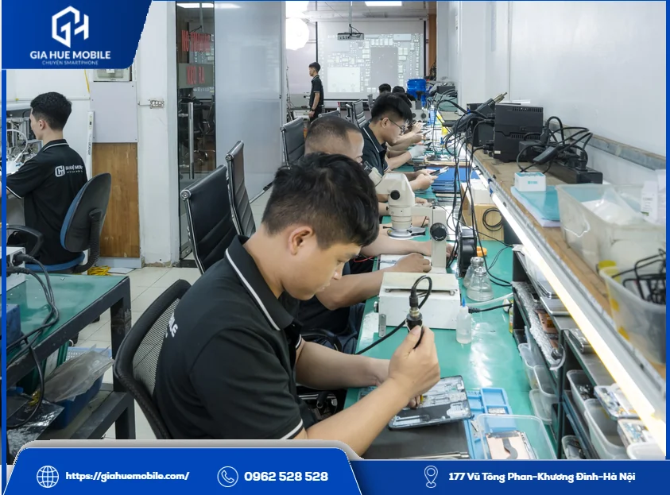
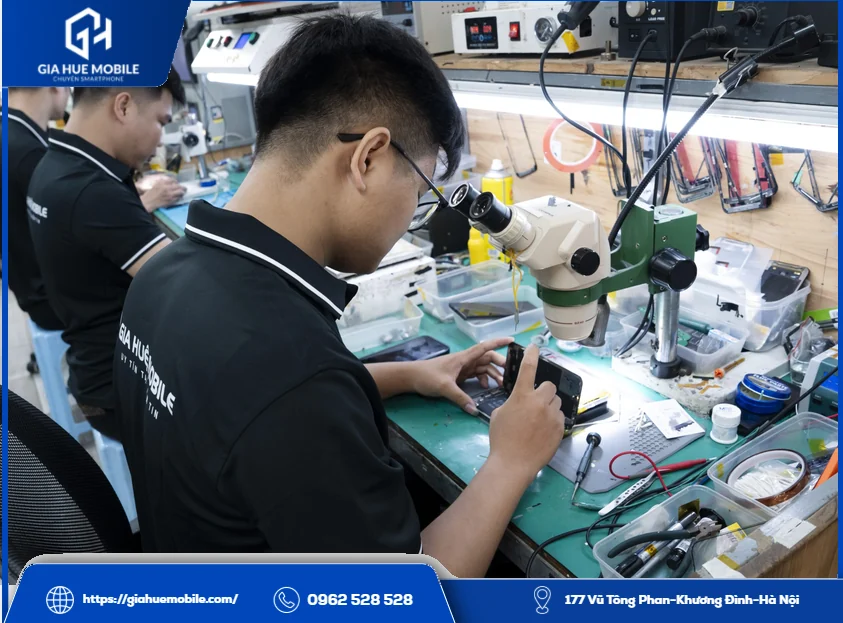
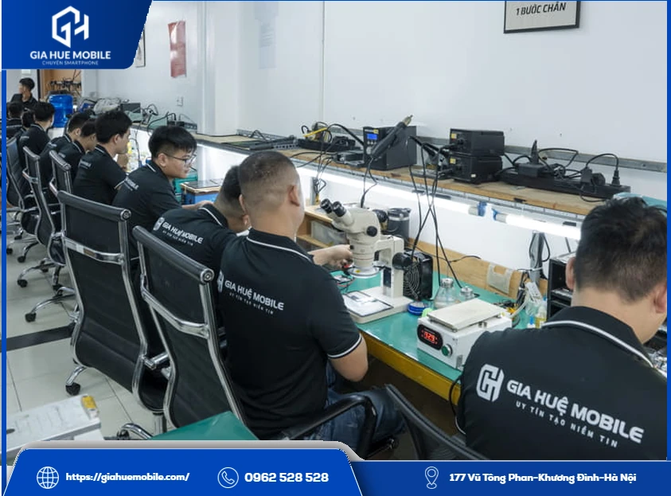

# Thay màn hình Vivo S19

**Thay màn hình Vivo S19** tại **Gia Huệ Mobile** mất khoảng 60–90 phút, luôn có sẵn linh kiện, dữ liệu vẫn giữ nguyên, bảo hành lỗi cảm ứng 1 đổi 1 trong 6 tháng. Cần thay khi tấm nền hoặc cảm ứng đã hỏng; chỉ vỡ kính mà hình vẫn đẹp thì nên kiểm tra trước.

*Màn hình vỡ kính nặng, tình trạng cần kiểm tra trước khi thay màn hình Vivo S19*

## 1. Làm sao biết màn mới của Vivo S19 đạt yêu cầu?

Vivo S19 dùng [màn hình AMOLED](https://vi.wikipedia.org/wiki/AMOLED) 6,78 inch, 2800×1260 (1.5K), 120Hz, độ sáng tối đa công bố 4500 nit, có vân tay dưới màn. Máy càng nhiều tính năng gắn với màn thì càng nên tự kiểm tra trước khi rời cửa hàng. Sáu việc dưới đây chỉ mất vài phút:
1. **Nền trắng:** mở ảnh trắng, xem có ám vàng, ám hồng hay loang không.
2. **Nền đen:** mở ảnh đen trong phòng tối, xem có đốm sáng hay hở sáng ở viền không.
3. **Độ sáng:** kéo thanh sáng từ thấp lên cao, màn phải đổi đều, không nháy.
4. **Tần số quét:** chọn 120Hz trong Cài đặt rồi vuốt, xem có giữ đúng mức đã chọn không. Đọc thêm [thay màn hình Vivo có còn 120Hz không](https://giahuemobile.com/thay-man-hinh-vivo-v30e-co-con-120hz-khong/).
5. **Cảm ứng:** rê ngón tay khắp màn, góc nào cũng phải ăn.
6. **Vân tay và camera trước:** mở khóa vài lần, chụp thử ảnh selfie.
Bên mình cũng thử các mục này trước khi giao máy, bạn cứ kiểm tra lại cùng kỹ thuật viên.

*Kỹ thuật viên kiểm tra máy trên bàn kỹ thuật trước khi thay màn hình Vivo S19*

## 2. Nên và chưa nên thay màn hình Vivo S19 khi nào?

Nên thay khi lỗi đã nằm ở tấm nền hoặc cảm ứng.
**Nên thay:**
- Mực loang, mảng đen lớn dần.
- Không lên hình dù máy vẫn đổ chuông.
- Cảm ứng tự bấm hoặc liệt nặng.
**Chưa nên vội thay:**
- Kính vỡ, hình đẹp, chạm đều: xem xét ép kính nếu máy đủ điều kiện.
- Sọc, nháy, tấm nền không nứt: kiểm tra cáp màn trước.
Máy thường hỏng màn sau khi rơi, bị đè hoặc vào nước.

## 3. Chi phí khi thay màn hình Vivo S19

Hiện để **Liên hệ** vì giá đổi theo đợt nhập; gọi **0962 528 528** để có giá trọn gói, đã báo là không phát sinh chi phí.
Máy dùng Màn Zin, thời gian khoảng 60–90 phút nếu máy không có lỗi đi kèm. Bảo hành lỗi cảm ứng 1 đổi 1 trong 6 tháng, không cần giữ phiếu vì tra được bằng số điện thoại. Vỡ kính, cấn bể, chảy mực hoặc vào nước sau khi nhận máy thì không bảo hành, chi tiết ở [chính sách bảo hành](https://giahuemobile.com/chinh-sach-bao-hanh/).

*Khay linh kiện tại xưởng Gia Huệ Mobile, nơi nhận thay màn hình Vivo S19*

## 4. Tại Gia Huệ Mobile, máy của bạn được làm thế nào?

Làm công khai trên bàn kỹ thuật, từng bước đều có bạn đồng ý.
**Bước đầu** là xem máy và ký phiếu tình trạng. Sau đó bên mình báo lỗi, báo giá.
**Bước giữa** là làm mềm keo, tách màn, vệ sinh khung rồi cắm thử màn mới. Đạt mới lắp và dán đầy đủ keo tếp kháng nước quanh viền.
**Bước cuối** là cùng bạn kiểm tra theo danh sách trên, ký tên lên linh kiện, nhận lại màn cũ, kích hoạt bảo hành điện tử.
**Gia Huệ Mobile** có 22 năm làm nghề, thấy thêm lỗi là báo trước. Kiểm tra và vệ sinh máy miễn phí, có hỗ trợ xuất hóa đơn VAT, hoàn tiền theo chính sách khi lỗi thuộc về cửa hàng.

*Kính hiển vi và dụng cụ tại bàn kỹ thuật dùng khi thay màn hình Vivo S19*

## 5. Hỏi thêm về thay màn hình Vivo S19

### Kiểm tra thấy màn chưa ổn thì sao?

Báo ngay khi còn ở cửa hàng để kỹ thuật viên xem lại. Lỗi cảm ứng trong 6 tháng thì được đổi theo bảo hành.

### Màn mới có sáng bằng màn cũ không?

Bạn so ngay khi nhận máy bằng thanh độ sáng. Màn Zin là loại bên mình dùng cho máy này.

### Vivo S19 và S19 Pro có dùng chung màn không?

Hai máy cùng cỡ 6,78 inch, nhưng đừng tự suy ra là lắp lẫn được. Hãy báo đúng tên máy.

### Thay màn có mất ảnh không?

Không, vì việc thay màn không động tới bộ nhớ. Máy còn dùng được thì nên sao lưu trước.

### Giá thay màn hình Vivo S19 có gồm công không?

Giá báo là giá trọn gói, không phát sinh sau khi đã báo.

### Thay xong có sợ nước không?

Có. Keo mới giúp hạn chế hơi ẩm, nhưng máy đã tháo ra sửa thì nên tránh nước.

## 6. Đường tới Gia Huệ Mobile

*Đội kỹ thuật của Gia Huệ Mobile, nơi nhận thay màn hình Vivo S19 tại Hà Nội*

**Cơ sở 1:** [177 Vũ Tông Phan, Khương Đình, Thanh Xuân, Hà Nội](https://www.google.com/maps/search/?api=1&query=Gia+Huệ+Mobile+177+Vũ+Tông+Phan+Khương+Đình+Thanh+Xuân+Hà+Nội) · Hotline **0962 528 528**

**Cơ sở 2:** [22 Thái Hà, Trung Liệt, Đống Đa, Hà Nội](https://www.google.com/maps/search/?api=1&query=Gia+Huệ+Mobile+22+Thái+Hà+Trung+Liệt+Đống+Đa+Hà+Nội) · Hotline **0986 980 802**
Bạn lưu danh sách kiểm tra ở đầu bài, dùng được cho mọi nơi khi **thay màn hình Vivo S19**.
**Tham khảo:** [Thay màn hình Vivo S17](https://giahuemobile.com/san-pham/thay-man-hinh-vivo-s17/) · [Thay màn hình Vivo S16](https://giahuemobile.com/san-pham/thay-man-hinh-vivo-s16/) · [Thay pin Vivo](https://giahuemobile.com/danh-muc-san-pham/sua-dien-thoai-vivo/thay-pin-vivo/) · [Thay màn hình Vivo](https://giahuemobile.com/danh-muc-san-pham/sua-dien-thoai-vivo/thay-man-hinh-vivo/) · [Trang chủ Gia Huệ Mobile](https://giahuemobile.com/)
