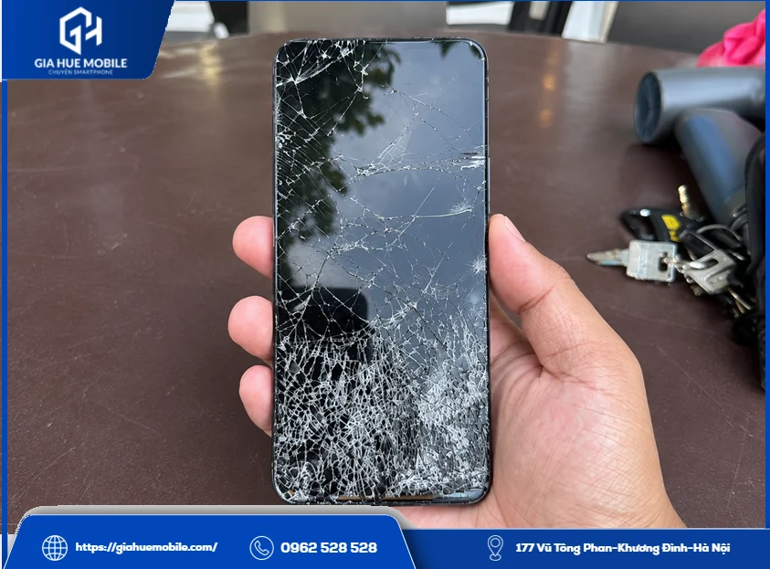
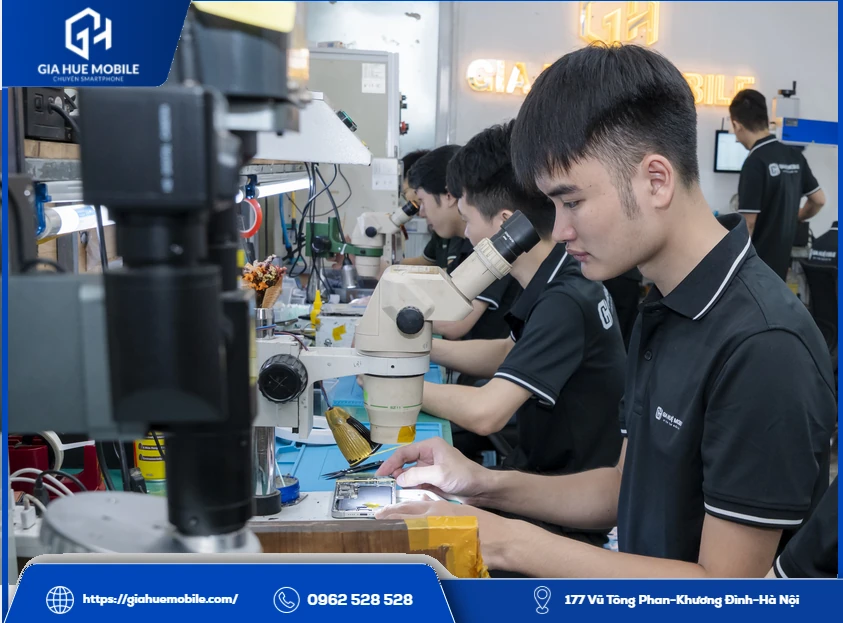
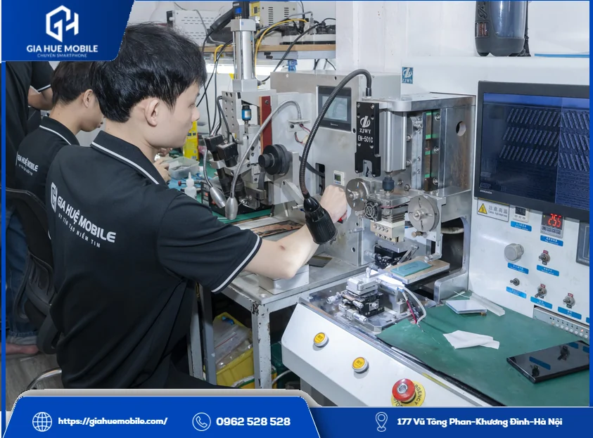
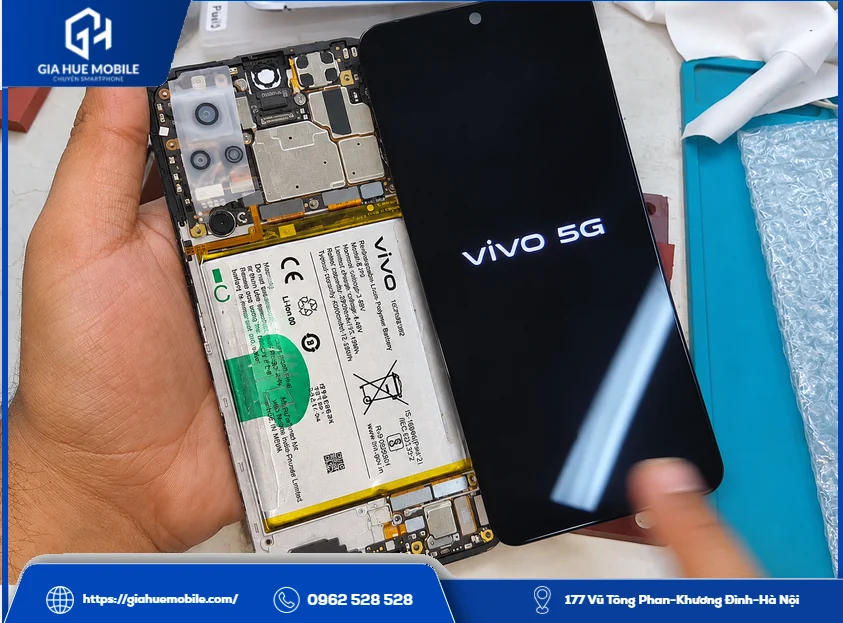
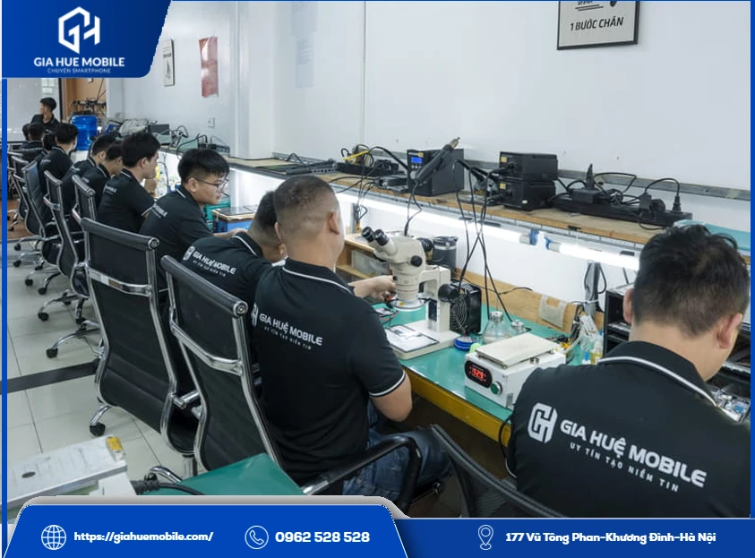

# Thay màn hình Vivo V21

**Thay màn hình Vivo V21** đáng làm khi tấm nền hoặc cảm ứng đã hỏng mà máy vẫn chạy tốt. Tại **Gia Huệ Mobile**, việc thay mất khoảng 60–90 phút, luôn có sẵn linh kiện, dữ liệu giữ nguyên, bảo hành lỗi cảm ứng 1 đổi 1 trong 6 tháng, và được kiểm tra miễn phí trước khi quyết định.

*Điện thoại vỡ kính phần dưới màn, tình trạng cần kiểm tra trước khi thay màn hình Vivo V21*

## 1. Vivo V21 hỏng màn có đáng thay không?

Đáng, nếu ngoài cái màn ra máy vẫn dùng tốt. V21 là máy dùng [màn hình AMOLED](https://vi.wikipedia.org/wiki/AMOLED) 6,44 inch, Full HD+, 90Hz, thay đúng màn thì gần như lấy lại được cách dùng cũ mà không phải cài đặt, chuyển dữ liệu sang máy khác.

Bạn nên cân nhắc kỹ hơn khi máy còn lỗi khác đi kèm:

- **Từng vào nước:** lỗi có thể không chỉ nằm ở màn.
- **Khung máy cong, móp góc:** màn mới khó ôm khít, dễ cấn khi lắp.
- **Máy đã chậm, pin yếu:** nên hỏi giá trước rồi so với nhu cầu dùng tiếp.

Bên mình báo rõ tình trạng và giá, còn thay hay không là bạn quyết.

## 2. Ba cách tự kiểm tra trước khi mang máy đi

Bạn có thể tự biết sơ bộ lỗi nằm ở đâu chỉ trong vài phút.

### Khởi động lại và tháo ốp, miếng dán

Ốp cấn hoặc miếng dán lỗi đôi khi làm cảm ứng nhảy loạn. Tháo ra, khởi động lại mà vẫn bị thì mới nghĩ tới màn.

### Chụp màn hình rồi xem trên máy khác

Thấy sọc mà ảnh chụp màn hình mở trên máy khác vẫn bình thường, lỗi thường nằm ở phần hiển thị chứ không phải phần mềm.

### Gọi vào máy khi màn đen

Máy vẫn đổ chuông nghĩa là máy còn chạy, nhiều khả năng dữ liệu vẫn lấy được sau khi xử lý màn.

*Kỹ thuật viên soi kính hiển vi để xác định lỗi trước khi thay màn hình Vivo V21*

## 3. Lỗi nào phải thay màn hình Vivo V21, lỗi nào chưa cần?

Hỏng tấm nền thì phải thay, còn hỏng lớp kính ngoài hoặc cáp thì thường còn cách khác.

| Bạn thấy gì | Khả năng cao là | Cách xử lý |
|---|---|---|
| Kính rạn, hình vẫn nét, chạm vẫn ăn | Vỡ lớp kính ngoài | Xem xét ép kính |
| Sọc, nháy, không có vết nứt tấm nền | Lỗi ở cáp màn | Kiểm tra cáp, có thể chưa phải thay |
| Mảng đen lan dần, vệt mực | Tấm nền đã nứt | Thường phải thay màn |
| Tự bấm loạn, liệt cả vùng lớn | Hỏng cảm ứng | Thường phải thay, kiểm tra rồi mới kết luận |

Lỗi hay bắt đầu từ một cú rơi, hoặc do máy bị đè trong túi, trong balo.

*Máy ép cáp tại Gia Huệ Mobile, dùng khi lỗi nằm ở cáp và chưa cần thay màn hình Vivo V21*

## 4. Thay màn hình Vivo V21 hết bao nhiêu và bảo hành thế nào?

Giá báo theo thời điểm nhập linh kiện, bạn gọi **0962 528 528** sẽ có con số trọn gói trước khi làm, không phát sinh chi phí.

- **Loại màn:** Màn Zin.
- **Giá:** Liên hệ.
- **Thời gian:** khoảng 60–90 phút nếu máy không có lỗi đi kèm.
- **Bảo hành:** lỗi cảm ứng 1 đổi 1 trong 6 tháng, tra theo số điện thoại.

Bảo hành không áp dụng khi màn bị vỡ, cấn, chảy mực hoặc vào nước sau khi nhận máy. Điều kiện đầy đủ nằm ở trang [chính sách bảo hành](https://giahuemobile.com/chinh-sach-bao-hanh/).

## 5. Thay màn hình Vivo V21 tại Gia Huệ Mobile diễn ra thế nào?

Bạn ngồi đợi và xem thợ làm được, thường nhận máy ngay trong ngày.

Đầu tiên, **Gia Huệ Mobile** kiểm tra máy miễn phí trước mặt bạn, ghi tình trạng lên phiếu rồi hai bên cùng ký. Sau đó bên mình nói rõ lỗi và giá. Bạn đồng ý thì kỹ thuật viên mới làm mềm keo, tách màn cũ và vệ sinh khung máy. Bạn được ký tên lên linh kiện và nhận lại màn cũ.

*Cắm thử màn mới cho lên hình khi đang mở máy, một bước khi thay màn hình Vivo V21*

Màn mới được cắm thử cho lên hình như ảnh trên, đạt rồi mới lắp cố định và dán đầy đủ keo tếp kháng nước quanh viền để màn bám chắc, hạn chế bụi và hơi ẩm. Cuối cùng, bên mình vệ sinh máy miễn phí, kích hoạt bảo hành điện tử và hỗ trợ xuất hóa đơn VAT khi bạn cần.

## 6. Nhận máy xong nên thử gì?

Thử ngay tại cửa hàng ba chỗ gắn liền với màn của V21, có gì chưa ổn thì báo luôn.

- **Vùng giọt nước ở đỉnh màn:** mở camera trước, xem ảnh selfie có mờ không.
- **Vân tay dưới màn:** mở khóa vài lần, nhận chậm thì đăng ký lại.
- **Độ mượt 90Hz:** vuốt khắp màn, xem có vùng nào chạm không ăn không.

Về nhà, bạn nên dán kính cường lực, dùng ốp có gờ bảo vệ và tránh để máy tiếp xúc với nước.

## 7. Thắc mắc hay gặp khi thay màn hình Vivo V21

### Màn hình Vivo V21 và V21 5G có dùng chung không?

Hai máy được công bố có màn tương tự nhau, nhưng bên mình vẫn đối chiếu trên máy thật trước khi lắp. V21e thì bạn nên báo riêng.

### Thay màn hình Vivo V21 giá bao nhiêu?

Giá đang để Liên hệ, bạn gọi 0962 528 528 và báo đúng tên máy để nhận giá.

### Có phải để máy lại qua đêm không?

Thường là không, nếu máy không có lỗi đi kèm.

### Thay màn có phải cài lại máy không?

Không. Thay màn không động tới bộ nhớ, ảnh và ứng dụng vẫn nguyên, nhưng còn thao tác được thì bạn nên sao lưu trước.

### Tự mua màn về thay được không?

Không nên nếu chưa quen tay, vì màn dán keo chặt vào khung, tháo sai dễ rách cáp. Đọc thêm về [lỗi vân tay sau khi thay màn Vivo](https://giahuemobile.com/thay-man-hinh-vivo-x80-pro-co-mat-van-tay-khong/).

### Thay xong có còn kháng nước như cũ không?

Không nên coi là như cũ. Keo mới giúp hạn chế bụi và hơi ẩm, nhưng máy đã tháo ra sửa thì bạn vẫn nên tránh nước.

## 8. Thay màn hình Vivo V21 ở đâu tại Hà Nội?

*Khu kỹ thuật của Gia Huệ Mobile, nơi nhận thay màn hình Vivo V21 tại Hà Nội*

**Cơ sở 1:** [177 Vũ Tông Phan, Khương Đình, Thanh Xuân, Hà Nội](https://www.google.com/maps/search/?api=1&query=Gia+Huệ+Mobile+177+Vũ+Tông+Phan+Khương+Đình+Thanh+Xuân+Hà+Nội) · Hotline **0962 528 528**

**Cơ sở 2:** [22 Thái Hà, Trung Liệt, Đống Đa, Hà Nội](https://www.google.com/maps/search/?api=1&query=Gia+Huệ+Mobile+22+Thái+Hà+Trung+Liệt+Đống+Đa+Hà+Nội) · Hotline **0986 980 802**

Còn phân vân có nên **thay màn hình Vivo V21** không, bạn cứ mang máy qua, xem xong rồi quyết cũng chưa muộn.

**Có thể bạn cần:** [Thay pin Vivo V21](https://giahuemobile.com/san-pham/thay-pin-vivo-v21/) · [Thay kính Vivo](https://giahuemobile.com/danh-muc-san-pham/sua-dien-thoai-vivo/thay-kinh-vivo/) · [Thay màn hình Vivo V23 5G](https://giahuemobile.com/san-pham/thay-man-hinh-vivo-v23-5g/) · [Thay màn hình Vivo](https://giahuemobile.com/danh-muc-san-pham/sua-dien-thoai-vivo/thay-man-hinh-vivo/) · [Gia Huệ Mobile sửa điện thoại tại Hà Nội](https://giahuemobile.com/)
