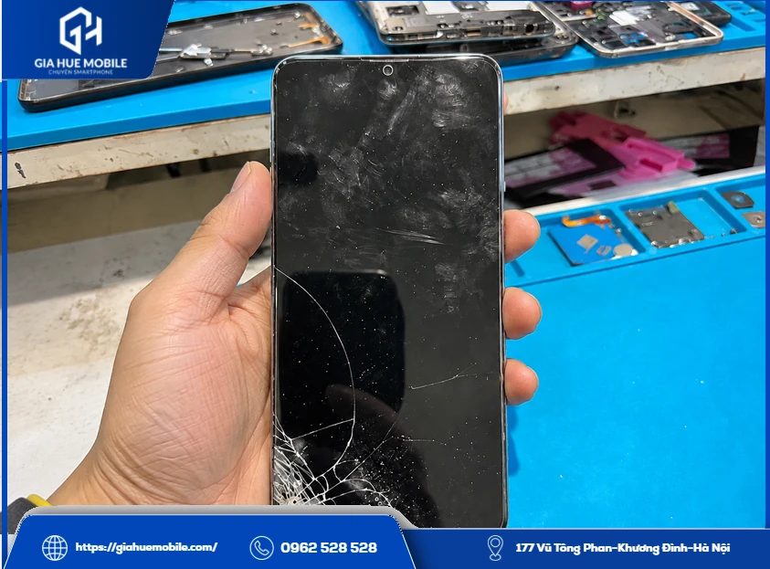
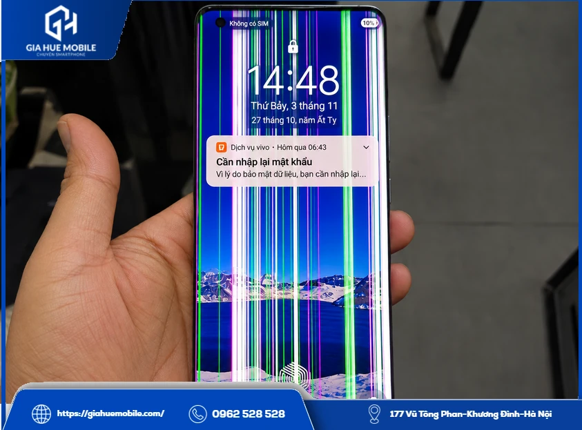
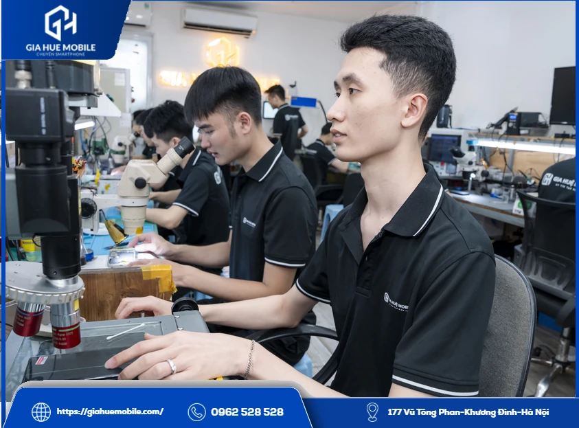
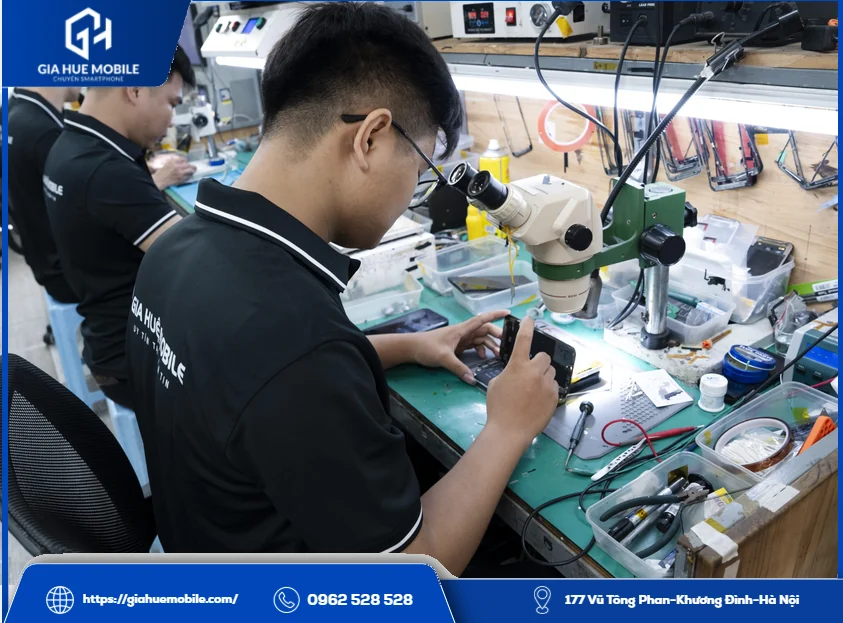
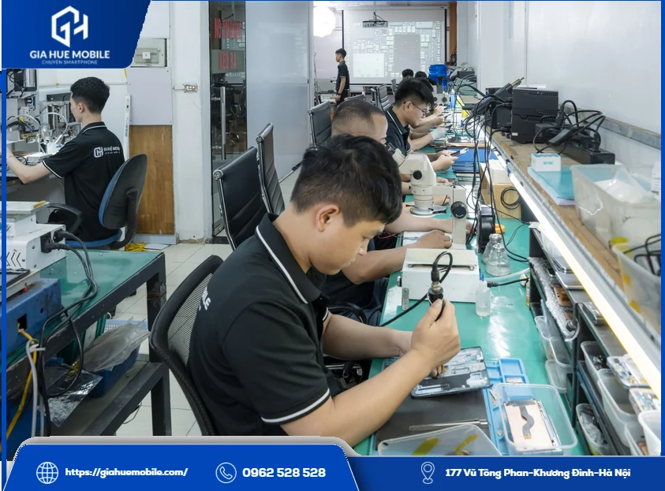

# Thay màn hình Vivo X50

Kính Vivo X50 nứt nhẹ ở góc mà hình vẫn đẹp, chạm vẫn ăn thường chưa phải thay cả màn; màn đen mà máy còn đổ chuông thì ảnh thường vẫn nằm trong bộ nhớ. Khi đã có sọc dày, mực loang hay máy tự bấm loạn, bạn nên cân nhắc đổi màn. **Gia Huệ Mobile** kiểm tra trước để xác định đúng lỗi.

Khi máy không kèm lỗi khác, **thay màn hình Vivo X50** thường mất khoảng 60–90 phút. Bản X50 màn phẳng, còn X50 Pro màn cong, nên cửa hàng đối chiếu đúng máy rồi nối thử màn: test thử, ưng ý mới thay. Màn được **dán đầy đủ keo tếp kháng nước**, bạn có thể ngồi theo dõi.

Bạn biết giá trọn gói trước khi máy được mở. Khi chưa làm, lúc kiểm tra thấy thêm lỗi thì cửa hàng báo lại cho bạn; lỗi do cửa hàng thì cửa hàng bồi thường. Bảo hành 6 tháng dành cho lỗi cảm ứng, lưu theo số điện thoại.

## 1. Màn Vivo X50 khác X50 Pro ở điểm nào?

Khác nhau rõ nhất ở phần cạnh màn. Thông số còn lại gần như giống nhau, nên nhiều người tưởng hai màn dùng chung.

| Thông số | Vivo X50 | Vivo X50 Pro |
|---|---|---|
| Loại màn | [AMOLED](https://vi.wikipedia.org/wiki/AMOLED) 6,56 inch | AMOLED 6,56 inch |
| Độ phân giải | 2376×1080 | 2376×1080 |
| Tần số quét | 90Hz | 90Hz |
| Cạnh màn | **Phẳng** | **Cong** |
| Vân tay | Dưới màn | Dưới màn |

Máy của bạn là bản Pro thì xem trang [thay màn hình Vivo X50 Pro](https://giahuemobile.com/san-pham/thay-man-hinh-vivo-x50-pro/). Không rõ bản nào, bạn mở Cài đặt xem tên máy, hoặc để kỹ thuật viên xem giúp.

Màn phẳng không có hai cạnh cong, nên khâu tách màn và dán keo thường dễ kiểm soát hơn màn cong. Đó là lợi thế khi sửa máy này.

## 2. Màn hỏng kiểu này có phải đi thay ngay không?

Tùy mức độ. Bạn có thể dựa vào ba nhóm dưới đây để biết nên đi sớm tới đâu.

### Còn chờ được vài hôm

*Điện thoại nứt góc màn, tình trạng cần kiểm tra trước khi thay màn hình Vivo X50*

Nứt nhẹ ở góc như ảnh trên, hình vẫn đẹp, chạm vẫn ăn. Máy còn dùng được, nhưng bạn nên sao lưu sẵn và tránh để máy nơi ẩm, vì vết nứt có thể lan.

### Nên đi trong tuần này

Vết nứt lan dần, có sọc mờ, thỉnh thoảng nháy, hoặc cảm ứng lúc được lúc không. Càng để lâu càng khó còn lựa chọn khác ngoài việc thay.

### Nên đi ngay

*Màn hình bị nhiều sọc màu dọc, lỗi cần kiểm tra để biết có phải thay màn hình Vivo X50 không*

Sọc dày khắp màn như ảnh trên, mực loang lớn dần, màn đen hẳn, hoặc máy tự bấm loạn. Nếu máy còn thao tác được, bạn sao lưu ngay trước khi màn tắt hẳn.

Những lỗi này thường bắt nguồn từ rơi máy, bị đè trong túi, balo hoặc vào nước.

## 3. Thay màn hình Vivo X50 hay ép kính, sửa cáp?

*Kỹ thuật viên kiểm tra dưới kính hiển vi trước khi thay màn hình Vivo X50*

Chỉ thay khi tấm nền hoặc cảm ứng đã hỏng. Kính vỡ mà hiển thị và cảm ứng còn tốt thì có thể xem xét [thay kính Vivo](https://giahuemobile.com/danh-muc-san-pham/sua-dien-thoai-vivo/thay-kinh-vivo/). Sọc hay nháy mà tấm nền không nứt, không chảy mực thì nên kiểm tra cáp màn trước, vì có thể chưa phải thay.

## 4. Thay màn hình Vivo X50 tốn bao nhiêu?

Giá đang để **Liên hệ** vì đổi theo từng đợt nhập màn. Bạn gọi hoặc nhắn Zalo **0962 528 528**, nói rõ máy X50 để nhận giá trọn gói. Lúc kiểm tra thấy thêm lỗi thì cửa hàng báo lại cho bạn.

Cửa hàng dùng Màn Zin, làm khoảng 60–90 phút nếu máy không có lỗi đi kèm. Bảo hành 6 tháng cho lỗi cảm ứng, tra theo số điện thoại. Màn vỡ, cấn, chảy mực hoặc vào nước sau khi nhận máy thì nằm ngoài [chính sách bảo hành](https://giahuemobile.com/chinh-sach-bao-hanh/).

## 5. Thay màn Vivo X50, bạn thường băn khoăn điều gì?

Người dùng Vivo X50 thường băn khoăn về việc lắp nhầm màn X50 Pro, vân tay không nhận và giá đổi khi mở máy. Trước khi **thay màn hình Vivo X50**, cửa hàng xử lý từng điều như sau:

| Điều băn khoăn | Việc cửa hàng làm |
|---|---|
| Lắp nhầm màn cong của X50 Pro | Đối chiếu tên máy, so màn phẳng trên máy thật trước khi lắp |
| Vân tay dưới màn không nhận | Cắm màn mới, thử vân tay trước khi dán keo |
| Màu màn mới không như ý | Nối thử để bạn xem màu, độ sáng, cảm ứng, ưng ý mới thay |
| Ảnh trong máy biến mất | Thay màn thông thường không mất dữ liệu, thông tin quan trọng vẫn nên sao lưu |
| Giá đổi sau khi mở máy | Giá trọn gói báo trước; thấy thêm lỗi lúc kiểm tra thì báo lại; lỗi do cửa hàng thì cửa hàng bồi thường |
| Màn mới bị tráo | Bạn ký tên lên linh kiện, ngồi xem sửa, nhận lại màn cũ |

## 6. Nhận được gì khi thay màn hình Vivo X50 tại Gia Huệ Mobile?

Khi **thay màn hình Vivo X50** tại **Gia Huệ Mobile**, bạn nhận được màn phẳng đúng đời máy đã thử trước khi lắp. Giá được báo trước, lỗi cảm ứng được bảo hành 6 tháng, bên cạnh đó còn có:

- **Kiểm tra miễn phí:** rõ lỗi, rõ giá rồi bạn mới quyết định.
- **Dán đầy đủ keo tếp kháng nước:** dây chun giữ màn lúc keo bám, viền máy khít hơn.
- **Mượn điện thoại miễn phí:** vẫn giữ liên lạc trong lúc máy đang sửa.
- **Bảo hành điện tử:** tra cứu trực tuyến theo số điện thoại.
- **Hóa đơn VAT:** cửa hàng hỗ trợ xuất khi bạn cần.

## 7. Một lượt thay màn tại Gia Huệ Mobile

*Bàn kỹ thuật tại xưởng Gia Huệ Mobile, nơi thực hiện thay màn hình Vivo X50*

Bạn ngồi cùng kỹ thuật viên từ đầu đến cuối, việc nào cũng rõ ai làm gì.

| Lúc | Kỹ thuật viên làm | Bạn làm |
|---|---|---|
| Nhận máy | Kiểm tra miễn phí, ghi tình trạng lên phiếu | Xem và cùng ký phiếu |
| Báo giá | Nói rõ lỗi, giá trọn gói | Đồng ý thì mới làm |
| Tháo màn | Làm mềm keo, tách màn cũ, vệ sinh khung | Ký tên lên linh kiện |
| Thử màn | Cắm màn mới, kiểm tra hiển thị, cảm ứng, vân tay | Xem cùng |
| Dán keo | **Dán đầy đủ keo tếp kháng nước** quanh viền | Chờ thợ hoàn tất |
| Trả máy | Kích hoạt bảo hành điện tử | Gọi thử, nhận lại màn cũ |

**Gia Huệ Mobile** có 22 năm làm nghề, thấy thêm lỗi thì báo trước; lỗi do cửa hàng thì cửa hàng bồi thường.

## 8. Khách hay hỏi gì về màn Vivo X50?

### Màn X50 lắp cho X50 Pro được không?

Không nên, vì X50 màn phẳng còn X50 Pro màn cong. Bên mình đối chiếu trên máy thật trước khi lắp.

### Thay màn hình Vivo X50 giá bao nhiêu?

Bạn gọi 0962 528 528 để nhận giá trọn gói theo thời điểm.

### Máy sọc màu có chắc phải thay không?

Chưa chắc. Tấm nền không nứt, không chảy mực thì có thể do cáp, cần xem máy mới biết.

### Màn đen thì có lấy lại được ảnh không?

Thường vẫn được, vì ảnh nằm trong bộ nhớ của máy. Thay màn xong là xem lại bình thường.

### Thay xong vân tay có chạy không?

Chạy được nếu màn tương thích và lắp đúng kỹ thuật. Bên mình thử trước khi dán keo, máy nhận chậm thì bạn đăng ký lại.

### Máy thay màn rồi có dùng khi trời mưa được không?

Dính ít nước chưa hẳn sao, nhưng bạn đừng chủ quan. Keo mới chỉ giúp hạn chế hơi ẩm, không biến máy thành máy chống nước.

## 9. Mang máy tới hai cơ sở tại Hà Nội

*Đội kỹ thuật Gia Huệ Mobile tại Hà Nội, nơi nhận thay màn hình Vivo X50*

**Cơ sở 1:** [177 Vũ Tông Phan, Khương Đình, Thanh Xuân, Hà Nội](https://www.google.com/maps/search/?api=1&query=Gia+Huệ+Mobile+177+Vũ+Tông+Phan+Khương+Đình+Thanh+Xuân+Hà+Nội) · Hotline **0962 528 528**

**Cơ sở 2:** [22 Thái Hà, Trung Liệt, Đống Đa, Hà Nội](https://www.google.com/maps/search/?api=1&query=Gia+Huệ+Mobile+22+Thái+Hà+Trung+Liệt+Đống+Đa+Hà+Nội) · Hotline **0986 980 802**

Máy mới nứt góc hay đã lên sọc đều nên cho thợ xem trước, rồi mới quyết có **thay màn hình Vivo X50** hay không.

**Trang liên quan:** [Thay màn hình Vivo X60 Pro](https://giahuemobile.com/san-pham/thay-man-hinh-vivo-x60-pro/) · [Thay màn hình Vivo X70 Pro](https://giahuemobile.com/san-pham/thay-man-hinh-vivo-x70-pro/) · [Thay màn hình Vivo](https://giahuemobile.com/danh-muc-san-pham/sua-dien-thoai-vivo/thay-man-hinh-vivo/) · [Gia Huệ Mobile sửa điện thoại tại Hà Nội](https://giahuemobile.com/)
